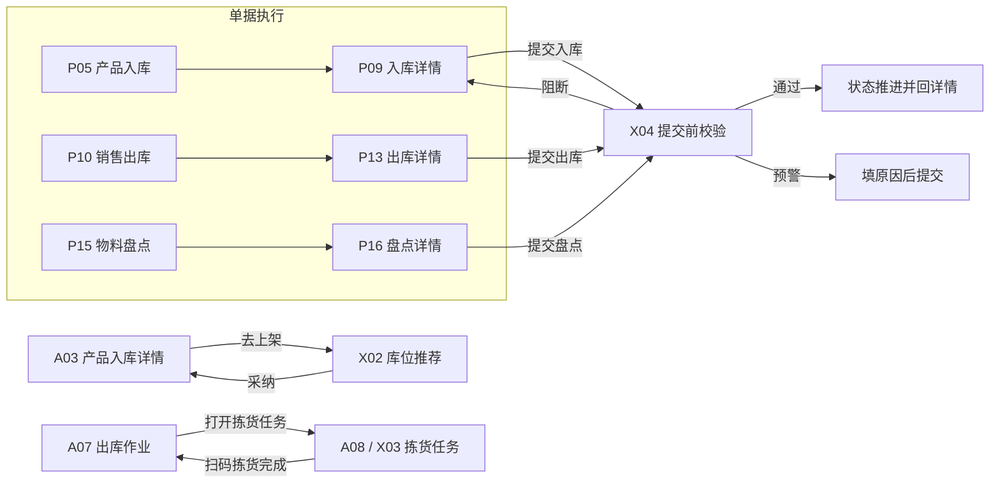
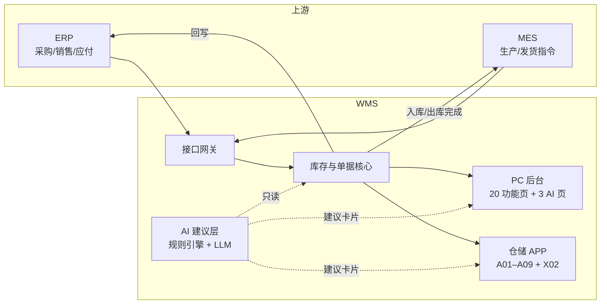
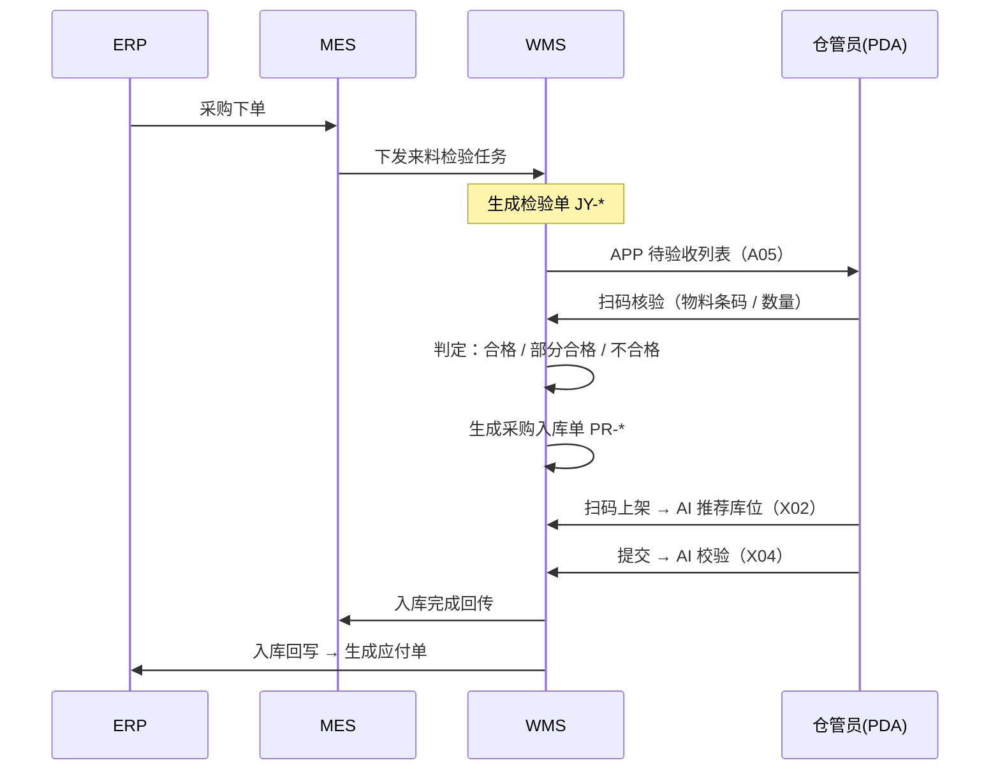
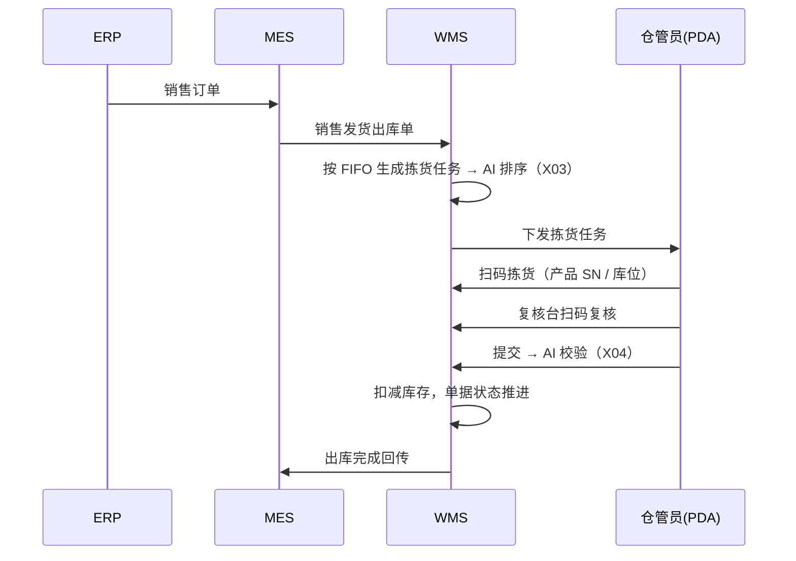
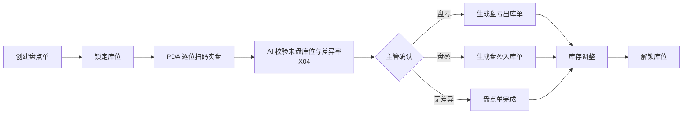
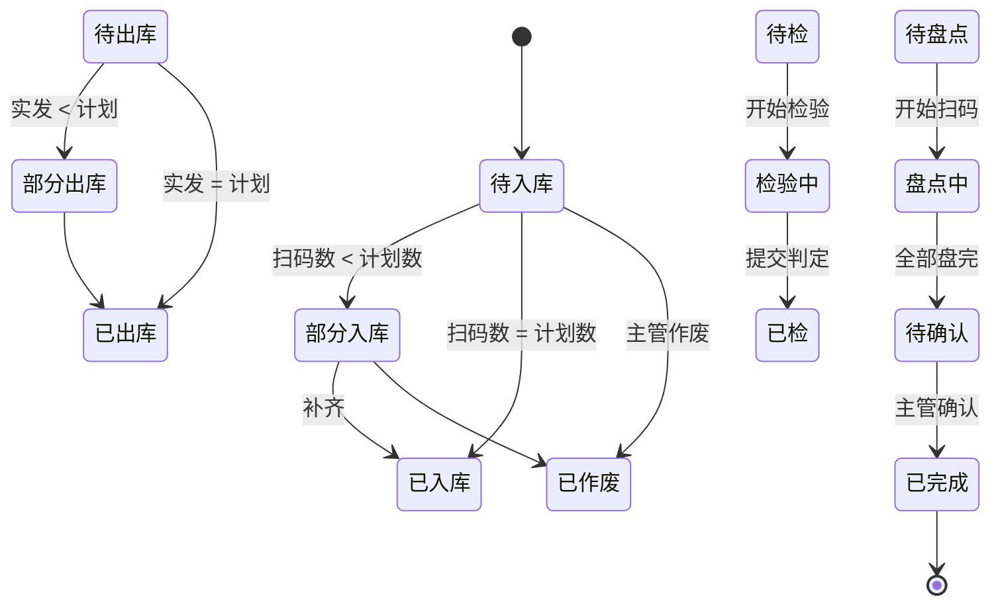

# WMS 仓储管理系统 · 产品需求文档 V2.1

| 项目 | 内容 |
|---|---|
| 产品名称 | WMS 仓储管理系统（PC 后台 + 仓储 APP + AI 建议层） |
| 文档版本 | **V2.1** |
| 文档状态 | 评审中 |
| 编写日期 | 2026-10-28 |
| 文档性质 | 完整版：功能基线（原 V1）+ AI 增量（原 V2），合并重写 |
| 关联原型 | `wms-prototype-v2.1.html`（34 屏） |

**版本关系**

| 版本 | 文档 | 内容 | 状态 |
|---|---|---|---|
| V1.0 | 已删除（2026-10-29） | 功能基线，26 屏，字段级需求 | 已被本文档完整吸收 |
| V2.0 | 已删除（2026-10-29） | AI 增量方案，只写增量 | 已被本文档完整吸收 |
| **V2.1** | 本文档 | 功能基线 + AI 增量，统一页面口径与校验机制 | 当前版本 |

> V1.0 / V2.0 是过程稿，内容已全部并入本文档，原件不再保留，避免口径分歧。对应的旧原型 `wms-prototype.html` / `wms-prototype-v2.html` 同样不再维护，现役原型只有 `wms-prototype-v2.1.html`。

**V2.1 相对旧版的三处修正**

| # | 修正 | 说明 |
|---|---|---|
| 1 | 页面数量口径 | 旧版首页写「PC 21 屏 / APP 4 屏 / 登录 1 屏」，登录本身属于 PC 屏、APP 实际只有 5 屏，统计重复且错误；且 APP 工作台列出的 10 个入口里有 7 个没有承载页。V2.1 统一为 **PC 功能 20 + 登录 1 + APP 8 = 29**，V2.1 新增 5 屏后 **共 34 屏** |
| 2 | AI 植入口径 | 旧版写「6 处 AI 植入」，未区分「新增页面」与「既有页面嵌入点」。V2.1 拆成 **5 个新增页面 + 6 个既有页面嵌入点**，逐条列明位置与形式 |
| 3 | 提交校验范围 | 旧版称「三个详情页」但原型只有独立校验页，未说明如何进入、如何返回。V2.1 新增第 8 章专章定义触发范围、进入路径、三类单据的规则差异与结果处置 |

---

## 1. 产品概述

### 1.1 背景

工厂仓储当前依赖 ERP 台账 + 手工 Excel，存在三个硬伤：

1. **账实不符**：出入库靠人工登记，单据与实物不同步，月度盘点差异率长期高于 3%。
2. **链路断裂**：ERP 下达的采购 / 销售 / 生产指令无法直达仓库作业层，靠电话与纸质单据传递，平均流转 4 小时以上。
3. **判断力锁在人身上**：选哪个库位、先拣哪一单、这个数量对不对，全靠老师傅经验与事后盘点暴露。

### 1.2 产品定位

面向**单工厂、单租户**的仓储执行系统（WES 层）：向下管理库位与实物，向上承接 ERP / MES 的业务指令，中间用扫码把每一次实物移动变成可追溯的库存事务。

在此基础上叠加一层 **AI 建议层**：不接管系统，只在四个瞬间递上一张卡片——上架时的库位、拣货时的顺序、提交前的校验、老板问数时的答案。

> 一句话：**让仓库的每一次进出都有单据、有扫码、有回传；让每一个判断都有依据、可采纳、可拒绝。**

### 1.3 目标与指标

| 目标 | 指标 | 现状 | 目标值 |
|---|---|---|---|
| 账实一致 | 月度盘点差异率 | > 3% | < 0.5% |
| 作业提效 | 单张入库单处理时长 | ~25 min | < 8 min |
| 链路打通 | 单据从 ERP 下达到仓库可见 | 4 h（人工） | < 1 min |
| 作业准确 | 扫码校验覆盖率 | 0 | 100% 出入库动作 |
| 判断可复用 | AI 建议采纳率 | — | 库位 ≥ 60%，路径 ≥ 75%，问数 ≥ 70% |
| 现场可用 | APP 日活 / 仓管员总数 | — | > 90% |

### 1.4 范围

**包含**：库存查询、出入库流水、四类入库、三类出库、来料检验、盘点、移位、仓库/库位/条码基础资料、仓储 APP（A01–A09），以及 AI 建议层的五个能力。

**不包含**（列入后续版本或其它系统）：
- 多仓调拨、越库（Cross-docking）、波次拣货
- 库内加工、组合拆解、批次/效期管理（本版只到 SKU 级）
- 计费、月台预约、AGV / 立库设备对接
- 财务成本核算（由 ERP 承担）
- 需求预测、动态安全库存（无 6 个月数据前不做，见第 16 章）
- APP 生产投料确认（原型有图标但无需求定义，见 6.8.1 与 16.4）

### 1.5 设计原则

| 原则 | 说明 |
|---|---|
| 库存只能被单据改变 | 任何库存增减必须挂靠一张单据，禁止后台直接改库存数字 |
| 扫码即事实 | 出入库数量以扫码结果为准，纸面计划值仅作对照 |
| 上游驱动、下游回传 | 单据由 MES / ERP 生成，WMS 执行并回写，不反向下发指令 |
| 异常留痕 | 超收、盘亏、检验不合格、带差异提交、离线补传均记录操作人与原因 |
| 移动优先 | APP 覆盖仓管员 100% 现场动作，PC 只做查询、配置与审批 |
| **AI 只建议、人确认** | AI 对核心层只有读权限，不改变任何单据状态、不动一个库存数字 |

---

## 2. 页面清单与口径

本章是 V2.1 新增，用于消除页面统计与 AI 植入位置的歧义。后续章节的页面编号均以此为准。

### 2.1 页面总数

| 类别 | 数量 | 编号区间 |
|---|---|---|
| 登录 | 1 | L01 |
| PC 功能页 | 20 | P01 – P20 |
| APP 页面 | 9 | A01 – A09（其中 A08 与 X03 同屏） |
| **V1 基线合计** | **29** | 登录 1 + PC 20 + APP 8（A08 属 AI 新增，不计入基线） |
| V2.1 新增（AI） | 5 | X01 – X05 |
| **V2.1 合计** | **34** | 29 + 5，A08 不重复计屏 |

> 口径说明：登录页虽为 PC 形态，但单独计数，不计入「PC 功能页」；APP 共 9 个页面编号，其中拣货任务（A08）同时是 AI 新增页 X03，只计一屏。工作台列出的每个入口都必须有承载页，不允许出现点了没反应的图标。

### 2.2 PC 功能页（20）

| 编号 | 页面 | 所属一级菜单 |
|---|---|---|
| P01 | 成品库存明细 | 实时库存查询 |
| P02 | 物料库存明细 | 实时库存查询 |
| P03 | 产品出入库查询 | 出入库查询 |
| P04 | 物料出入库查询 | 出入库查询 |
| P05 | 产品入库 | 入库管理 |
| P06 | 采购入库 | 入库管理 |
| P07 | 生产退料 | 入库管理 |
| P08 | 盘盈入库 | 入库管理 |
| P09 | 入库详情 | 入库管理 |
| P10 | 销售出库 | 出库管理 |
| P11 | 领料出库 | 出库管理 |
| P12 | 盘亏出库 | 出库管理 |
| P13 | 出库详情 | 出库管理 |
| P14 | 来料检验 | 库内作业管理 |
| P15 | 物料盘点 | 库内作业管理 |
| P16 | 盘点详情 | 库内作业管理 |
| P17 | 物料移位 | 库内作业管理 |
| P18 | 仓库管理 | 基础设置 |
| P19 | 库位管理 | 基础设置 |
| P20 | 条码管理 | 基础设置 |

### 2.3 APP 页面（5）

| 编号 | 页面 | 说明 |
|---|---|---|
| A01 | 工作台 | 按业务域分组的图标宫格 + 底部双 Tab |
| A02 | 产品入库（列表） | 卡片式待入库列表 |
| A03 | 产品入库详情 | 单箱明细 + 扫码补录 + 上架入口 |
| A04 | 采购入库 | 按入库单号聚合的收货卡片 |
| A05 | 来料验收 | 待验收 / 已验收卡片 |
| A06 | 入库作业 | 生产退料 + 盘盈入库的待执行列表（两类共用骨架，按类型过滤） |
| A07 | 出库作业 | 销售出库 + 生产领料的待拣货列表（两类共用骨架，按类型过滤） |
| A08 | 拣货任务 | 即 X03：AI 路径排序 + 扫码拣货，出库作业的执行页 |
| A09 | 库内作业 | 物料盘点 + 物料移位的待执行列表（两类共用骨架，按类型过滤） |

### 2.4 V2.1 新增页面（5）

| 编号 | 页面 | 形态 | 服务对象 | 对应能力 |
|---|---|---|---|---|
| X01 | 智能问数 | PC | 厂长 / 主管 | 自然语言只读问数 |
| X02 | 库位推荐 | APP（A03 进入）+ PC 详情页内嵌卡片 | 仓管员 | 上架选位建议 |
| X03 | 拣货任务 | APP（即 A08） | 仓管员 | 拣货顺序优化 |
| X04 | 提交前校验 | PC | 仓管员 / 主管 | 单据提交前规则校验 |
| X05 | AI 效果看板 | PC | 主管 / 管理层 | 采纳率与效果度量 |

> X02 / X03 在 PC 端**不新增页面**：PC 入库详情（P09）与出库详情（P13）内以建议卡片形式呈现，点击「选择库位」/「按 AI 建议排序」就地展开，不跳转到 APP 专属页。因此 PC 的 AI 新增页只有 X01 / X04 / X05 三个，APP 侧新增 X02 / X03 两个。

### 2.5 AI 融入既有页面的位置（6 处）

除 5 个新增页面外，AI 还以**按钮、标签、跳转**的形式嵌入既有页面。这类改动不新增页面，但改变原有交互路径，因此单独列明。

| # | 所在页面 | 形式 | 跳转 / 效果 |
|---|---|---|---|
| 1 | P09 入库详情 · 标题栏右侧 | 「提交入库」按钮 + 提示「提交前自动跑 11 条校验」 | → X04（入库单） |
| 2 | P13 出库详情 · 标题栏右侧 | 「提交出库」按钮 + 同样提示 | → X04（出库单） |
| 3 | P16 盘点详情 · 标题栏右侧 | 「提交盘点」按钮 + 提示「提交前校验差异与未盘库位」 | → X04（盘点单） |
| 4 | P13 出库详情 · 「出库明细」标题旁 | 蓝色标签「AI 已按拣货路径排序」 | 无跳转，仅说明顺序来源；点击可切回「按库位编码」顺序 |
| 5 | P09 入库详情 · 「库位」字段旁 | 文字链接「选择库位」→ 就地展开推荐卡片（主推 + 2 备选 + 3 条理由） | 不跳页；卡内提供采纳 / 换一个 / 忽略 |
| 6 | A03 产品入库详情 · 卡片列表下方 | 主按钮「扫码完成，去上架选位」 | → X02 库位推荐 |

**不嵌入的位置**：各业务列表页（P05、P10 等）不出现 AI 元素。原因是列表用于快速扫描定位单据，插入建议会干扰视线；AI 只在「将要做一个动作」的位置出现。

> 旧版「6 处 AI 植入」的说法作废，以此表为准（5 个新增页面 + 6 处既有页面嵌入）。

### 2.6 页面流转关系



---

## 3. 用户与权限

### 3.1 角色定义

| 角色 | 人员 | 使用端 | 核心职责 |
|---|---|---|---|
| 仓管员 | 收货组 / 发货组 | APP 为主，PC 查询 | 扫码收货、上架、拣货、发货、移位 |
| 检验员 | 质检部 | PC + APP | 来料检验、判定合格 / 部分合格 / 不合格 |
| 仓库主管 | 仓储部 | PC | 盘点组织、盈亏确认、单据异常处理、报表 |
| 系统管理员 | IT | PC | 仓库 / 库位 / 条码 / 账号 / 权限配置 |
| 集成账号 | MES、ERP | 接口 | 下发指令、接收回传（无 UI 权限） |

### 3.2 权限矩阵

| 功能 | 仓管员 | 检验员 | 仓库主管 | 管理员 |
|---|:--:|:--:|:--:|:--:|
| 库存查询 / 流水查询 | ✅ | ✅ | ✅ | ✅ |
| 入库单执行（扫码收货） | ✅ | — | ✅ | — |
| 入库单提交 / 作废 | 提交 | — | 提交 + 作废 | 提交 + 作废 |
| 来料检验判定 | — | ✅ | — | — |
| 检验单复核 | — | — | ✅ | — |
| 出库单执行（拣货发货） | ✅ | — | ✅ | — |
| 出库单提交 | 提交 | — | 提交 + 作废 | 提交 + 作废 |
| 盘点单创建 / 盈亏确认 | — | — | ✅ | — |
| 移位单创建 | ✅ | — | ✅ | — |
| 仓库 / 库位 / 条码维护 | 只读 | 只读 | 只读 | ✅ |
| AI 建议采纳 | ✅ | — | ✅ | ✅ |
| 智能问数（X01） | 仅本仓 | 仅本仓 | 全部仓库 | 全部仓库 |
| AI 效果看板（X05） | — | — | ✅ | ✅ |
| 权限与账号管理 | — | — | — | ✅ |

**数据权限**：仓管员默认只可见被分配的仓库；主管可见全部；管理员可见全部。问数（X01）严格继承该数据权限，不得跨仓越权。

> 权限矩阵中的「仅本仓」指**可用范围**而非**目标用户**：X01 的目标用户是厂长 / 主管（见 7.1），仓管员开放本仓只读是为了一线自查，不鼓励作为常规取数入口。

---

## 4. 系统架构与信息架构

### 4.1 端与外部系统



| 端 | 形态 | 主要场景 |
|---|---|---|
| PC 后台 | 1280 宽 Web | 库存查询、单据查询与详情、基础资料、盘点组织、校验与审批、问数 |
| 仓储 APP | 移动端（PDA / 手机） | 扫码收货、上架选位、拣货、发货、盘点、移位、来料验收 |

**AI 层的架构位置**：横跨在核心层之上，对核心层只有读权限。规则引擎是主算力，LLM 是可选增强；断网或 LLM 不可用时，库位推荐、路径优化、提交校验完整可用，仅问数降级隐藏。

### 4.2 信息架构

| 一级菜单 | 二级菜单 | 页面编号 |
|---|---|---|
| — | 登录 | L01 |
| 实时库存查询 | 成品库存明细 / 物料库存明细 | P01 / P02 |
| 出入库查询 | 产品出入库查询 / 物料出入库查询 | P03 / P04 |
| 入库管理 | 产品入库 / 采购入库 / 生产退料 / 盘盈入库 / 入库详情 | P05–P09 |
| 出库管理 | 销售出库 / 领料出库 / 盘亏出库 / 出库详情 | P10–P13 |
| 库内作业管理 | 来料检验 / 物料盘点 / 盘点详情 / 物料移位 | P14–P17 |
| 基础设置 | 仓库管理 / 库位管理 / 条码管理 | P18–P20 |
| **AI 建议层** | 智能问数 / 库位推荐 / 拣货路径 / 提交前校验 / AI 效果看板 | X01–X05 |
| 仓储 APP 端 | 工作台 / 产品入库 / 产品入库详情 / 采购入库 / 来料验收 / 入库作业 / 出库作业 / 拣货任务 / 库内作业 | A01–A09 |

---

## 5. 核心业务流程

### 5.1 采购入库（ERP → MES → WMS）



**AI 参与点**：上架环节的库位推荐、提交环节的规则校验。

**关键节点**
1. 检验单未判定前，物料处于「待检库存」，不可被领料占用。
2. 判定为「部分合格」时，只对合格数量生成入库单，不合格部分进入拒收区并回传 MES。
3. 上架必须扫库位码，系统校验库位状态、类型匹配、剩余容量。

### 5.2 销售出库（ERP → MES → WMS）



**状态推进**：`未出库` → `部分出库` → `已出库`，由实发数量与计划数量比对自动推进。

### 5.3 来料检验判定

| 结果状态 | 触发条件 | 后续动作 |
|---|---|---|
| 合格 | 实收 = 计划，且全部条码校验通过、质检合格 | 生成采购入库单，全量入库 |
| 部分合格 | 实收 < 计划，或部分物料不在单据明细内 / 质检不合格 | 按合格数量生成入库单，差异部分生成拒收记录 |
| 合格（超收） | 实收 > 计划，且全部条码校验通过、质检合格 | 超出比例 ≤ 阈值（默认 5%）自动生成入库单；超出转人工 |
| 不合格 | 质检不合格 | 不生成入库单，物料退回 |

### 5.4 盘点与盈亏



**规则**：盘点期间库位锁定，任何出入库请求被拒绝并提示「库位盘点中」。盈亏必须走对应单据，不允许直接修正库存。

### 5.5 物料移位

APP 发起 → 扫源库位码 → 扫物料码 → 扫目标库位码 → 系统改写库存的库位维度，总量不变，生成移位流水。

---

## 6. 功能需求（PC 20 屏 + APP 5 屏）

> 每节格式：**目标 → 字段 / 列 → 规则 → 异常**。未标注的字段均为只读展示；搜索区字段为空表示不加该条件。

### 6.1 登录（L01）

| 字段 | 类型 | 规则 |
|---|---|---|
| 用户名称 | 文本 | 必填，4–32 字符 |
| 登录密码 | 密码 | 必填，8–32 位，bcrypt 存储 |
| 校验码 | 文本 | 必填，4 位，不区分大小写，60 秒过期 |
| 记住密码 | 复选 | 仅保存用户名 |

**规则**：连续 5 次密码错误锁定 10 分钟；登录后按角色跳转（仓管员 → P01，检验员 → P14，主管/管理员 → P01）；access token 有效期 2 小时、无操作 8 小时强制登出，refresh token 7 天（见架构 7.1）。

---

### 6.2 实时库存查询

#### 6.2.1 成品库存明细（P01）

搜索：产品名称、产品编码、更新日期（区间）。

| 列 | 说明 |
|---|---|
| 产品编码 | 如 A3288 |
| 产品名称 | 如 iphone16 |
| 规格型号 | 多行：尺寸、屏幕、分辨率、亮度 |
| 产品数量 | 当前总库存（含锁定） |
| 产品单位 | 台 / 个 |
| 最新入库日期 | 该 SKU 最后入库完成时间 |

**规则**：默认按最新入库日期倒序；数量为 0 仍展示（灰显）；点击行下钻到该 SKU 出入库流水。

#### 6.2.2 物料库存明细（P02）

搜索：物料名称、物料编码、更新日期。

| 列 | 说明 |
|---|---|
| 物料编码 / 物料名称 / 物料类型 / 单位 | — |
| 总库存数量 | 物理库存 |
| 当前可用库存 | 总库存 − 锁库 − 冻结 |
| 在途库存 | 已下采购单未到货（只读，来自 ERP 采购订单推送，落地到 `in_transit` 表，见 10.2） |
| 安全库存 | 低于此值触发预警 |

**规则**：可用库存 < 安全库存时整行标黄并加「低库存」标识。

---

### 6.3 出入库查询

#### 6.3.1 产品出入库查询（P03）

搜索：产品名称、出入库类型（下拉）、时间区间（默认近 30 天）。

| 列 | 说明 |
|---|---|
| 产品编码 / 产品名称 | — |
| 业务单据 | 关联单据号，可跳详情 |
| 业务类型 | 入库为正、出库为负 |
| 数量 | 带符号，负数红色 |
| 剩余库存 | 该笔事务完成后的结存 |
| 时间 | 事务发生时间 |
| 操作 | 查看单据 |

**规则**：流水只增不改，不可删除；导出上限 5 万行。

#### 6.3.2 物料出入库查询（P04）

结构同 P03，业务类型为：采购入库 / 生产领料 / 生产退料 / 盘盈入库 / 盘亏出库 / 移位（移出与移入各一条）。

---

### 6.4 入库管理

四类入库共用同一套列表与详情骨架，差异在**来源单据**与**可编辑字段**。

#### 6.4.1 产品入库（P05）

搜索：产品名称、入库单号、生产任务单号、状态。

| 列 | 说明 |
|---|---|
| 入库单号 | 源自 MES，如 PI20260127001 |
| 生产任务单号 | 如 RWD202539560 |
| 包装编码 | 箱码，如 BOX20260127ABC123456 |
| 产品编码 / 产品名称 | — |
| 产品数量 | 计划入库数 |
| 入库状态 | 待入库 / 部分入库 / 已入库 |
| 操作 | 入库详情 |

**规则**
- 单据由 MES 推送生成，WMS 不可新增，只可执行与作废（主管）。
- 数量以扫码为准，扫码数 ≠ 计划数时状态置「部分入库」，差异需填原因。
- 同一箱码重复扫码提示「该箱码已入库」。

#### 6.4.2 采购入库（P06）

搜索：物料名称、入库单号、关联检验单号、状态。

| 列 | 说明 |
|---|---|
| 入库单号 | PR 前缀 |
| 检验单号 | 必填关联，无检验单不可入库 |
| 物料编码 / 物料名称 | — |
| 入库数量 | 本次入库数 |
| 库位 | 目标库位编码 |
| 入库状态 / 操作 | — |

**规则**：检验单须为「已检」且结果合格 / 部分合格 / 合格（超收），否则入库按钮置灰并提示原因；允许一个检验单拆成多次入库。

#### 6.4.3 生产退料（P07）

字段：退料单号、生产任务单号、包装编码、物料编码/名称、退料数量、入库状态、操作。

**规则**：退料必须回原库位；原库位停用则进入「待分配库位」，由主管指定。

#### 6.4.4 盘盈入库（P08）

| 列 | 说明 |
|---|---|
| 盘点单号 | 来源盘点单 |
| 物料编码 / 名称 | — |
| 盘盈数量 | 正数，红色加粗 |
| 入库仓库 / 入库状态 / 操作 | — |

**规则**：盘盈入库单只能由主管在盘点确认环节生成，仓管员无创建权限。

#### 6.4.5 入库详情（P09）

**布局**：面包屑 → 标题栏（返回 + 标题 + 「提交入库」按钮）→ 区块卡片。

| 区块 | 字段 / 列 |
|---|---|
| 基础信息 | 入库单号、生产任务单号、包装箱号、产品编码、产品名称、产品数量、单据状态、单据创建时间、单据创建人、入库人、入库时间 |
| 箱内产品明细 | 序号、产品名称、产品 SN 码 |

**规则**
- 已入库单据全字段只读；待入库允许修改库位与实收数量。
- 「库位」字段旁提供文字链接「选择库位」，点击就地展开 X02 推荐卡片（主推 + 2 备选 + 3 条理由），不跳页。
- SN 列表支持导出 CSV，用于售后追溯。
- 明细行数与「产品数量」不一致时高亮提示。
- **标题栏右侧固定「提交入库」按钮**，点击进入提交前校验（X04），详见第 8 章。

---

### 6.5 出库管理

#### 6.5.1 销售出库（P10）

搜索：产品名称、出库单号、销售订单号、状态。

| 列 | 说明 |
|---|---|
| 出库单号 | SO 前缀 |
| 销售订单号 | 来源 ERP |
| 产品编码 / 名称 | — |
| 计划出库数量 | MES 下发 |
| 实际出库数量 | 扫码累计 |
| 单据状态 | 待出库 / 部分出库 / 已出库 |
| 时间 / 操作 | — |

**规则**：实发 > 计划禁止提交；实发 < 计划允许，状态置「部分出库」，剩余可拆单继续发。

#### 6.5.2 领料出库（P11）

| 列 | 说明 |
|---|---|
| 领料单号 | PL 前缀 |
| 生产任务单号 | — |
| 物料编码 / 名称 | — |
| 需求数量 | 工单 BOM 计算 |
| 已发数量 | 累计实发 |
| 操作 | 领料详情 |

**规则**：按 FIFO 推荐库位；可用库存不足时提示缺口数量，允许部分发料（拆单）。

#### 6.5.3 盘亏出库（P12）

字段：盘点单号、物料编码/名称、盘亏数量（红色负数）、出库仓库、出库状态、操作。

**规则**：盘亏出库单由主管确认后自动生成，仓管员只执行实物出库。

#### 6.5.4 出库详情（P13）

| 区块 | 字段 / 列 |
|---|---|
| 基础信息 | 出库单号、领料订单编号、产品编码、产品名称、计划出库数量、实际出库数量、单据状态、单据创建人、单据创建时间 |
| 出库明细 | 序号、产品名称、产品 SN 码、库位信息、出库状态、出库人、出库时间 |

**规则**
- 明细逐行记录实际发出的 SN 与库位，作为发货凭证。
- 状态为「待出库」的行，出库人/时间不得有值。
- **「出库明细」标题旁显示标签「AI 已按拣货路径排序」**，仅在存在 AI 排序结果时出现；点击可切回「按库位编码」顺序。
- **标题栏右侧固定「提交出库」按钮**，进入 X04。

---

### 6.6 库内作业管理

#### 6.6.1 来料检验（P14）

搜索：检验编号、物流单号、检验时间。

| 列 | 说明 |
|---|---|
| 检验编号 | JY-yyyyMMdd-### |
| 物流单号 / 运输车牌号 | — |
| 来料检验状态 | 待检 / 检验中 / 已检 |
| 来料检验结果 | - / 合格 / 部分合格 / 不合格 / 合格（超收） |
| 单据创建人 / 创建时间 / 检验时间 | — |
| 操作 | 详情；已检额外提供「生成入库单」 |

**判定规则**

| 结果 | 触发节点 |
|---|---|
| 合格 | 实收 = 计划，全部条码校验通过，质检合格 |
| 部分合格 | 实收 < 计划，部分物料不在明细内 / 质量不合格 |
| 合格（超收） | 实收 > 计划，全部条码校验通过，质检合格 |
| 不合格 | 质检不合格或条码校验全部失败 |

**交互**：「检验中」禁止重复点击开始（乐观锁）；已生成入库单不可再次生成；判定不合格必须填原因，计入供应商质量档案。

#### 6.6.2 物料盘点（P15）

搜索：盘点单号、盘点类型、时间。按钮：查询、新增盘点单（主管以上）。

| 列 | 说明 |
|---|---|
| 盘点单号 | PD-yyyyMMdd-### |
| 盘点类型 | 全盘 / 抽盘 / 循环盘点 |
| 盘点仓库 / 盘点人 / 盘点时间 | — |
| 全部 / 已盘 / 未盘 | 应盘、已完成、剩余 |
| 盘亏 / 盘盈 | 差异条目数（红色） |
| 操作 | 盘点详情；有差异时提供「盘亏出库」「盘盈入库」 |

**规则**：创建即锁定库位；已盘 + 未盘 = 全部（前端实时校验）；盘亏/盘盈红色；未盘条目「实盘」为空而非 0；未完成可导出差异，不允许部分提交。

#### 6.6.3 盘点详情（P16）

| 区块 | 字段 / 列 |
|---|---|
| 盘点信息 | 盘点单号、盘点类型、全部、已盘、未盘、盘亏、盘盈、盘点人、盘点时间、盘点仓库 |
| 盘点明细 | 序号、物料名称、库位、账面、实盘、盘亏、盘盈 |

**规则**：仅「实盘」有值的行参与差异计算；提交后生成盈亏单据并写库存调整流水，盘点单转「已完成」；**标题栏右侧「提交盘点」按钮**进入 X04。

**盲盘 / 明盘差异**：盘点方式在创建时固化（BR-024）。盲盘模式下，「账面」列在 PDA 与 PC 均显示为 `—`，仅「实盘」「盘亏」「盘盈」可见，提交后揭晓差异；明盘模式实时显示账面数。盘点明细区顶部以标签标明当前模式（如「盲盘 · 生产默认盲盘」）。

#### 6.6.4 物料移位（P17）

字段：移库单号、物料编码/名称、移出库位、移入库位、数量、操作。

**规则**：目标库位容量不足时拒绝并提示剩余容量；移位不改总量，只改库位维度；移出库位为空后状态自动「空闲」；移位中源库位临时锁定。

---

### 6.7 基础设置

#### 6.7.1 仓库管理（P18）

搜索：仓库名称、仓库类型、仓库状态。

| 列 | 说明 |
|---|---|
| 仓库编码 / 名称 | WH-001 / 1#原料仓 |
| 仓库类型 | 彩色文字标签：原料（蓝）/ 成品（紫）/ 辅料（橙）/ 呆滞（红） |
| 库位数量 | 该仓库下启用库位数 |
| 状态 | 开关控件，切换即生效 |
| 负责人 / 操作 | — |

**规则**：停用前校验库存为 0 且无未结单据，否则拒绝并列出阻塞项。

#### 6.7.2 库位管理（P19）

| 列 | 说明 |
|---|---|
| 库位编码 / 名称 | KW-001 / 1#库位 |
| 库位类型 | 普通 / 立体 / 恒温 / 危品（彩色标签） |
| 所属仓库 | — |
| 库位容量（托盘）/（物料） | 数字 |
| 状态 | 空闲 / 占用 / 锁定 / 维保 |
| 操作 | 详情 / 编辑 |

**规则**：状态由系统自动流转（有库存→占用，空→空闲），人工只能设「锁定」「维保」；危品库位只能放危品物料；删除前必须为空。

#### 6.7.3 条码管理（P20）

搜索：条码类型。按钮：查询、新增条码、批量打印。

| 列 | 说明 |
|---|---|
| 条码 | 如 KQ-001 |
| 类型 | 库区 / 库位 / 物料 / 箱码 |
| 生成时间 | — |

**规则**：条码全局唯一；批量打印支持 40×30mm / 60×40mm 规格与份数，输出 PDF 或直连标签机。

---

### 6.8 仓储 APP（A01–A09）

#### 6.8.1 工作台（A01）

按业务域分组，**每个入口都必须有承载页**（映射见下表）。底部双 Tab：工作台 / 我的。

| 业务域 | 入口 | 承载页 |
|---|---|---|
| 入库管理 | 产品入库 | A02 |
| 入库管理 | 生产退料 | A06（类型=退料） |
| 入库管理 | 采购入库 | A04 |
| 入库管理 | 盘盈入库 | A06（类型=盘盈） |
| 出库管理 | 销售出库 | A07（类型=销售） |
| 出库管理 | 生产领料 | A07（类型=领料） |
| 库内作业 | 来料验收 | A05 |
| 库内作业 | 物料盘点 | A09（类型=盘点） |
| 库内作业 | 物料移位 | A09（类型=移位） |

**规则**：入口按角色权限动态显示（无权限隐藏而非置灰）；有待办时入口右上角显示数量角标。

> 「生产投料确认」在原型的图标存在但无任何需求定义（PC 20 屏中也没有对应功能），本版**不作为入口**，列入后续版本评估（见 16.4）。

#### 6.8.2 产品入库（A02）

卡片展示：产品编码 + 状态、产品名称、箱码、产品数量、操作人、时间。

**规则**：下拉刷新 + 上拉加载（每页 20）；点击进详情；离线扫码进本地队列，顶部显示「离线暂存 N 条」。

#### 6.8.3 产品入库详情（A03）

单箱明细 + 扫码补录 + **「扫码完成，去上架选位」主按钮**（→ X02）。

**规则**：上架按钮仅在扫码数量 ≥ 计划数量时可点（不足时提示先补录）；上架完成后自动返回本页并标记「已上架」。

#### 6.8.4 采购入库（A04）

卡片：入库单号 + 状态、关联检验单号、操作人、时间。点击进入扫码收货。

#### 6.8.5 来料验收（A05）

卡片：质检单号 + 状态、供应商编码、关联检验单号、操作人、时间。

**规则**：扫码实时显示「已扫 / 应扫」进度；判定提交后不可修改，需主管在 PC 冲销。

#### 6.8.6 入库作业（A06）

承载**生产退料**与**盘盈入库**两类待执行单据，列表骨架与 A02 一致，按入口传入的类型过滤。

| 卡片字段 | 退料 | 盘盈 |
|---|---|---|
| 单号 | RT 前缀 | SG 前缀 |
| 关联单号 | 生产任务单号 | 盘点单号 |
| 数量 | 退料数量 | 盘盈数量（正数） |
| 目标库位 | 原库位（停用则「待分配」） | 盘点仓库 |

**规则**：退料必须回原库位，原库位停用进入「待分配库位」由主管指定；盘盈入库单由主管在盘点确认环节生成，仓管员只执行实物入库；点击卡片进入与 A03 同构的入库详情。

#### 6.8.7 出库作业（A07）

承载**销售出库**与**生产领料**两类待拣货单据，卡片字段与 P10 / P11 对应列一致（单号、关联单号、物料、计划量、已发量、状态）。

**规则**：点击卡片进入拣货任务（A08）；实发 > 计划禁止提交；可用库存不足时提示缺口数量，允许部分发料（拆单）。

#### 6.8.8 拣货任务（A08 = X03）

逐库位的拣货清单，顶部显示建议顺序与预计行走距离，序号前以蓝色圆点标识「AI 排序」，可一键切回「按库位编码」。

**规则**：顺序只影响展示与行进指引，不改任务状态与派工；温控、危品满足「先普货后危品」硬约束；逐位扫码确认，全部确认后回 A07 并刷新已发数量。

#### 6.8.9 库内作业（A09）

承载**物料盘点**与**物料移位**两类待执行任务，按入口传入的类型过滤。

| 任务 | 内容 | 规则 |
|---|---|---|
| 物料盘点 | 应盘库位清单 + 逐位扫码实盘 | 盲盘时不显示账面数；已盘 + 未盘 = 全部；全部盘完才可提交 |
| 物料移位 | 扫源库位 → 扫物料码 → 扫目标库位 | 目标库位容量不足拒绝并提示剩余容量；移位中源库位临时锁定 |

---

### 6.9 业务配置项

以下参数不写死在代码里，由管理员在「基础设置 → 规则配置」维护（V2.1 新增，对应 Q-01、Q-02、Q-04、Q-05、Q-06、Q-10、Q-11 的决策落地）。

| 配置项 | 默认值 | 作用位置 | 说明 |
|---|---|---|---|
| 超收阈值 | 5% | 采购入库、校验 R4 | 全局默认；供应商档案可单独覆盖 |
| 数量偏差阈值 | 10% | 校验 R1 | 全局 |
| **盘点方式** | **盲盘** | 盘点单创建 | 盲盘：PDA 与 PC 均不显示账面数，提交后揭晓差异；明盘：实时显示账面 |
| 盘点差异率阈值 | 5% | 校验 R9 | 超过需主管二次确认 |
| 库位坐标必填 | 是 | 库位管理、X02 | 开启时，未填坐标的库位不参与推荐 |
| 属性完整率下限 | 95% | 上架校验、X02 | 低于此值不开放库位推荐（见 12.6） |
| 建议展示总开关 | 开 | X02 / X03 | 关闭后按系统默认逻辑运行，卡片不出现 |
| 单类建议静默期 | 7 天 | X02 / X03 | 用户点「不再提示」后，7 天内该类建议不展示 |
| 问数功能开关 | 开 | X01 | 关闭后入口隐藏，其余能力不受影响 |
| 采纳率下线阈值 | 30% | X05 / 运营 | 连续 2 周低于阈值，该类建议自动下线 |

**配置生效规则**
- 修改后对**新建**单据生效，已在途单据沿用创建时的快照值（避免半途规则变化导致数据不一致）。
- 阈值类配置的每次修改写入审计日志，记录修改人、时间、前后值。
- 「盘点方式」在盘点单创建时固化，创建后不可改。

---

## 7. AI 建议层

四个能力，统一遵守「只建议、人确认」：AI 对核心层只有读权限，任何写操作由人点击触发。

### 7.1 能力总览

| 层 | 能力 | 页面 | 服务对象 | AI 做什么 | AI 不做什么 |
|---|---|---|---|---|---|
| L1 执行 | 库位推荐 | X02 | 仓管员 | 5 维打分给出 Top1 + 3 条理由 | 不自动占用库位 |
| L1 执行 | 拣货路径 | X03（A08） | 仓管员 | 输出建议顺序与预计节省距离 | 不锁定任务、不改派工 |
| L2 管理 | 提交前校验 | X04 | 仓管员 / 主管 | 跑规则集，命中给归因与处置建议 | 不拦截提交，只警示 |
| L3 决策 | 自然语言问数 | X01 | 厂长 / 主管 | 理解问题、调指标、出结论与图表 | 不改数据、不建单据 |
| L3 决策 | AI 效果看板 | X05 | 主管 / 管理层 | 汇总采纳率与结果指标，暴露退化 | 不用于考核个人，不做归因到人 |

### 7.2 库位推荐（X02）

**触发**：A03 点击「去上架选位」；PC 入库详情（P09）点击「库位」字段旁的「选择库位」，就地展开推荐卡片（不跳页）。

| 输入特征 | 来源 | 冷启动可用 |
|---|---|---|
| 同物料聚合度 | 该 SKU 现有库位分布 | ✅ |
| 库位剩余容量 | 容量 − 已占 | ✅ |
| 距离权重 | 库位到出入口 / 打包台坐标距离 | ✅（需库位坐标系） |
| 物料属性约束 | 重量、体积、危品、温控 | ✅ |
| 周转率匹配 | 近 30 天出库频次 | ⏳ 需 30 天数据 |

**打分**：`score = w1·聚合度 + w2·容量适配 + w3·距离得分 + w4·周转匹配 − w5·约束惩罚`
默认 w1=0.35, w2=0.2, w3=0.25, w4=0.2, w5=1.0（硬约束直接淘汰）。冷启动（< 30 天）w4 置 0 后归一化。

**输出**：推荐库位（主推 + 2 备选）、置信度（高/中/低，基于分差）、3 条理由、约束提示、采纳 / 换一个 / 忽略。

**规则**
- 硬约束优先：危品入普通库位、超容量、锁定库位一律淘汰且不进备选。
- 置信度为「低」时不给 Top1，只并列 3 个候选。
- 采纳后写入反馈表；采纳率是核心度量指标。

### 7.3 拣货路径（X03）

**触发**：APP 出库作业（A07）点击卡片进入拣货任务（A08）；PC 出库详情（P13）打开时自动在「出库明细」区展示 AI 排序结果。

| 订单规模 | 策略 |
|---|---|
| ≤ 12 个拣货点 | 精确求解（TSP 动态规划，Held-Karp） |
| 13–50 个点 | 最近邻构造 + 2-opt 改进，与最优解误差 < 8% |
| > 50 个点 | 按库区聚类后区内 S 型路径 |

**输出**：建议顺序列表、预计行走距离与节省量（如「340m，较默认顺序少 180m（−35%）」）、一键切换「按 AI 建议 / 按库位编码」。

**规则**：温控、危品需满足「先普货后危品」硬约束；紧急插单只在队首插入并提示距离增量；建议只影响展示顺序，不改任务状态与派工。

### 7.4 提交前校验（X04）

详见第 8 章（含触发范围、进入路径、三类单据差异、结果处置）。

### 7.5 自然语言问数（X01）

**能力范围（只读）**

| 意图 | 示例 | 输出 |
|---|---|---|
| 库存查询 | 「A3288 现在还有多少」 | 数字 + 分库位明细 + 可用/锁定拆分 |
| 流水统计 | 「上周 A3288 出了多少」 | 汇总 + 按日趋势图 |
| 对比分析 | 「这个月比上个月出入库量涨了多少」 | 涨跌幅 + 双柱图 |
| 排名 | 「库存最多的 5 个物料」 | Top5 列表 |
| 单据检索 | 「昨天有哪些未完成的入库单」 | 单据列表 + 跳转 |
| 口径解释 | 「可用库存怎么算的」 | 指标定义 |

**回答结构（固定四段）**：结论 → 数据（表/图）→ 口径 → 下一步（查看明细 / 导出）。

**技术链路**：`自然语言 → LLM 意图分类 + 槽位抽取 → 指标语义层（指标名 → SQL 模板）→ 生成只读 SQL → 白名单校验 + 行数上限 5000 → 执行 → LLM 组织话术`。

**硬约束**
- 只允许 `SELECT`，禁止写操作；非法语句直接拒绝并记录。
- 单次查询行数上限 5000，超限提示缩小范围。
- 所有回答标注数据更新时间。
- 每次问数记录 question / generated_sql / 耗时，用于效果评估。
- 严格继承角色数据权限，仓管员问不到别的仓。

### 7.6 交互规范与信任设计

**卡片语言**

| 元素 | 规范 |
|---|---|
| 位置 | 出现在动作发生处，不弹模态遮挡现场 |
| 标题 | 一句结论式短句（「建议放到 A1-02-03」而非「库位推荐」） |
| 置信度 | 高 / 中 / 低三档，低置信度不推单一答案 |
| 理由 | 固定 3 条，每条 ≤ 20 字，可展开看数据依据 |
| 主操作 | 一个（采纳），其余次要（换一个 / 忽略） |
| 拒绝 | 必须可拒绝，拒绝可选原因（不合适 / 不信任 / 太慢） |
| 痕迹 | 采纳后折叠为一行「已采纳 AI 建议」，可撤销 |

**文案原则**：说人话、给理由、不装。禁用「智能优化」「赋能」；用「少走 180m」「同物料在这区已有 2 托」这类可验证事实。

**信任设计**

| 担心 | 设计回应 |
|---|---|
| AI 改错了谁负责 | AI 无写权限，变更由人点击触发 |
| 是不是乱猜 | 每条建议附 3 条事实理由，可看原始数据 |
| 用久成摆设 | 采纳率 < 30% 的建议类型自动下线复核 |
| 出错怎么复盘 | 建议带 trace_id，可回放输入、打分、理由 |
| 会不会被牵着走 | 保留「按系统默认 / 按库位编码」对照模式 |

### 7.7 降级策略

| 场景 | 影响 | 处理 |
|---|---|---|
| LLM 超时 3s | 问数、校验归因话术 | 回退模板文案，不影响结论 |
| LLM 完全不可用 | 仅问数 | X01 入口隐藏；X02/X03/X04 全部本地规则，正常可用 |
| 库位坐标缺失 | 距离得分 | 该维度权重置 0，退化为聚合 + 容量 |
| 历史数据不足 30 天 | 周转匹配 | 冷启动权重，仅用聚合/容量/距离 |

### 7.8 运营机制

AI 能力上线后不是「发完就不管」，需要三条运营规则防止它悄悄退化（对应 Q-04、Q-05、Q-06）。

| 机制 | 规则 | 触发方式 |
|---|---|---|
| 采纳率复核 | 某类建议连续 2 周采纳率 < 30%，自动下线并通知产品负责人 | 每周一 09:00 跑批 |
| 建议静默 | 用户点「不再提示」后，该类建议 7 天内不展示，第 8 天恢复一次试探 | 用户操作 |
| 全局开关 | 管理员可关闭建议展示（X02 / X03）或问数（X01），关闭后系统按默认逻辑运行，不弹提示 | 管理员操作，写审计 |

**自动生成的周报**：各类建议的展示量、采纳率、拒绝原因 Top3，以及结果指标变化（找位时长、拣货行走距离）。周报只发产品负责人，不发全员，避免变成考核工具。

### 7.9 AI 效果看板（X05）

**定位**：X05 是 AI 层的「体检页」，回答一个问题——这四个能力现在是在帮忙，还是在空转？

**权限**：仓库主管、系统管理员（见 3.2）。

**页面结构**

| 区块 | 内容 | 数据来源 |
|---|---|---|
| 采纳率总览 | 按场景（库位 / 路径 / 校验 / 问数）的展示量、采纳量、采纳率，含 30% 下线阈值标线 | `ai_suggestion` + `ai_feedback` |
| 结果指标 | 找位时长、拣货行走距离、校验拦截有效率、问数准确率，与上线前基线对比 | 运营指标（见 14.2） |
| 校验拦截有效性 | 各规则的命中次数、确认有效次数、误报次数 | `check_result` |
| 降级与静默 | 近 7 天 LLM 降级次数、静默中的用户数、已下线的建议类型 | `llm_usage` + 配置 |
| 问数质量 | 未命中语义层模板的问题 Top10、平均响应耗时 | 问数日志 |

**规则**
- 采纳率低于 30% 的场景在总览区标黄，并在连续 2 周低于阈值时显示「已自动下线」标记（对应 BR-022）。
- 看板只展示**聚合数据**，不展示单个操作员的采纳行为，避免变成考核工具。
- 数据延迟 ≤ 1 小时（跑批聚合），页面标注统计截止时间。
- 看板自身不产生建议、不提供任何写操作入口。

---

## 8. 提交前校验机制（X04）

本章为 V2.1 新增，用于统一「哪些单据会校验、从哪里进、三类单据有何差异、结果如何处置」。

### 8.1 触发范围

| 单据 | 是否校验 | 适用页面 | 规则集 | 阻断级规则 |
|---|:--:|---|---|---|
| 入库单（产品 / 采购 / 退料 / 盘盈） | ✅ | P09 入库详情 | R1–R5、R7（R7 仅采购入库） | R3 |
| 出库单（销售 / 领料 / 盘亏） | ✅ | P13 出库详情 | R1–R3、R5 | R3、R5 |
| 盘点单 | ✅ | P16 盘点详情 | R8–R11 | 无（全部为预警级） |
| 移位单 | ❌ | P17 | — | — |

> R6（时间异常）是**全局记录级**：三类单据提交时都跑，但只写审计、不计入「通过 / 预警 / 阻断」计数，也不影响提交按钮状态。R5 对入库单不适用（入库不减库存），跳过且不计入通过数。

> 移位单不校验，原因是移位不改变总量、影响面小；后续版本可纳入。

### 8.2 进入方式

| 方式 | 说明 |
|---|---|
| 详情页「提交」按钮 | 唯一入口。P09 / P13 / P16 标题栏右侧固定按钮 |
| 列表页 | **不提供**直接提交，避免误操作；必须先看详情 |
| 校验页内部 | 顶部三个 Tab 切换单据类型（入库单 / 出库单 / 盘点单），展示各自规则差异 |

Tab 上标有当前待提交的单据数量（如「出库单 2」）。进入时默认定位到来源单据所属的 Tab。

**角标口径**：角标数 = 当前用户有提交权限、状态为非终态（待入库 / 部分入库 / 待出库 / 部分出库 / 待盘点 / 盘点中）、且未被他人锁定的单据数。每 60 秒刷新一次；来源单据提交成功后，对应角标立即 −1。

### 8.3 规则集

| 编号 | 规则 | 判定 | 级别 | 处置建议 |
|---|---|---|---|---|
| R1 | 数量偏差 | 实际 vs 计划偏差 > 10% | 预警 | 核对实物，或填原因 |
| R2 | 重复扫码 | 同 SN / 箱码 24h 内重复 | 预警 | 定位重复行 |
| R3 | 库位类型不匹配 | 危品 / 恒温物料入错类型库位 | **阻断** | 必须改库位 |
| R4 | 超收比例 | 实收 > 计划且超 5% | 预警 | 转主管审批 |
| R5 | 可用库存不足 | 出库数量 > 当前可用 | **阻断** | 拆分单据或调整数量 |
| R6 | 时间异常 | 非工作时段批量提交 > 50 单/小时 | 记录 | 仅审计 |
| R7 | 供应商历史风险 | 近 3 批不合格率 > 20% | 预警 | 建议全检 |
| R8 | 未盘库位 | 提交时仍有未盘库位 | 预警 | 未盘按账面结转 |
| R9 | 差异率超阈值 | 盘亏项 / 应盘项 > 5% | 预警 | 主管二次确认 |
| R10 | 库位锁定状态 | 盘点期间有出入库事务 | 预警 | 账面数可能失真 |
| R11 | 单据完整性 | 已盘库位有空值 / 重复 | 预警 | 补录后重校 |

### 8.4 三类单据的规则差异（差异确认）

**入库单**（示例：PI20260127001，实收 112 / 计划 100）
- 3 项通过 · 1 项预警 · 0 项阻断
- R1 预警（+12%）→ 可填原因提交
- R4 通过（超收 0%，阈值 5%）
- R5 不适用（入库不校验库存），跳过且不计入通过数

**出库单**（示例：PL20260127003，需求 120 / 可用 96）
- 2 项通过 · 1 项预警 · **1 项阻断**
- R5 阻断（缺 24）→ 提交按钮置灰，必须「按 96 拆分生成一单」或「指定替代物料」
- R1 预警（−20%）→ 拆分后不影响工单，剩余 24 转入下一单

**盘点单**（示例：PD20260127001，已盘 88 / 100）
- 2 项通过 · 2 项预警 · 0 项阻断
- R8 预警（12 个未盘）→ 可选择「继续盘点」或直接提交（按账面结转）
- R9 预警（差异率 8.2%）→ 需主管二次确认后方可生成盈亏单据

### 8.5 结果处置与返回路径

| 校验结果 | 提交按钮 | 点击后行为 | 返回 |
|---|---|---|---|
| 全部通过 | 可点 | 直接提交 | 自动返回来源详情页（3 秒），状态标签刷新；对应列表页数据同步刷新 |
| 存在预警 | 可点 | 弹出原因输入（必填，≥ 5 字），确认后提交 | 同上；单据打「带差异提交」标，原因写入审计日志 |
| 存在阻断 | **置灰** | 不可提交，需点击处置建议 | 修正后重新从详情页进入校验 |

**提交成功后的连带动作**
1. 单据状态推进：入库单 → 已入库 / 部分入库；出库单 → 已出库 / 部分出库；盘点单 → 已完成。
2. 若为盘点单，自动生成盘亏出库单 / 盘盈入库单。
3. 触发 MES / ERP 回传（见第 13 章接口）。
4. 返回来源详情页并刷新，页面顶部提示「已提交，单据状态已更新」。

### 8.6 为什么在提交时校验，而不是扫码时

扫码动作每分钟数十次，逐次拦截会拖慢现场节奏且误报频繁；提交前一次性跑完全部规则，能在不打断作业的前提下覆盖全部校验项。

规则全部本地计算，整轮校验 P95 < 3s（原型实测 0.8–1.1s）；LLM 只负责把命中结果写成一句人话，超时则回退模板文案。

---

## 9. 单据状态机



| 单据 | 状态枚举 | 终态 |
|---|---|---|
| 入库单 | 待入库 / 部分入库 / 已入库 / 已作废 | 已入库、已作废 |
| 出库单 | 待出库 / 部分出库 / 已出库 / 已作废 | 已出库、已作废 |
| 检验单 | 待检 / 检验中 / 已检 | 已检 |
| 盘点单 | 待盘点 / 盘点中 / 待确认 / 已完成 / 已取消 | 已完成、已取消 |
| 移位单 | 待执行 / 执行中 / 已完成 | 已完成 |

**规则**：终态不可回退；作废需填原因并留痕，作废后关联库存事务反向冲销。

---

## 10. 数据模型

### 10.1 单据编号规则

统一规则：**业务前缀 + yyyyMMdd + 3 位流水**，全局唯一、不可复用、不跳号。

| 单据 | 前缀 | 示例 | 生成方 |
|---|---|---|---|
| 产品入库单 | PI | PI20260127001 | MES 推送 → WMS 落号 |
| 采购入库单 | PR | PR20260127001 | WMS（检验合格后生成） |
| 生产退料单 | RT | RT20260127001 | MES 推送 |
| 盘盈入库单 | SG | SG20260127001 | WMS（盘点确认后生成） |
| 销售出库单 | SO | SO20260127001 | MES 推送 |
| 领料出库单 | PL | PL20260127001 | MES 推送 |
| 盘亏出库单 | SL | SL20260127001 | WMS（盘点确认后生成） |
| 来料检验单 | JY | JY20260127001 | WMS（接收检验任务时生成） |
| 盘点单 | PD | PD20260127001 | WMS |
| 移位单 | YK | YK20260127001 | WMS（APP 发起） |
| 生产任务单 | RWD | RWD20260127001 | MES（外部编号，仅引用） |
| 生产领料需求 | SCLL | SCLL20260127001 | MES（外部编号，仅引用） |
| 销售订单 | XSDD | XSDD20260127001 | ERP（外部编号，仅引用） |
| 采购订单 | CGDD | CGDD20260127001 | ERP（外部编号，仅引用） |

**说明**
- 外部编号（RWD / SCLL / XSDD / CGDD）由上游系统生成，WMS 只做引用与展示，格式需与 MES / ERP 约定后锁定；本表格式为当前约定值。
- 包装箱码沿用 MES 的规则（`BOX` + yyyyMMdd + 批次字母 + 流水），WMS 不改写。
- 库位码（A1-01-01）、仓库码（WH-001）、条码（KQ-001）不属于单据编号体系，独立维护。
- **流水位数**：3 位为默认，指**单类单据**的日流水（上限 999）。规模假设中的「日均 800–2000 单」是全系统合计，分摊到 10 类前缀后单类通常远低于 999；若某类单日超过 999，该前缀流水自动扩为 4 位（左侧补零保持字典序），编号规则本身不变。

> 原型旧版本曾混用 KHDD / KDHD / RCK / CGRK / RK / KHOD 等前缀，同一张单在不同页面还不一致（如产品入库写成 KHDD、销售出库也写成 KHDD）。V2.1 已全部统一为上表规则。

### 10.2 实体定义

| 实体 | 关键字段 | 说明 |
|---|---|---|
| warehouse 仓库 | id, code, name, type, status, owner, created_at | 类型：原料/成品/辅料/呆滞料 |
| location 库位 | id, code, name, type, warehouse_id, cap_pallet, cap_material, status | 状态：空闲/占用/锁定/维保 |
| location_coord 库位坐标 | location_id, x, y, distance_to_dock, distance_to_pack | AI 距离得分与路径计算基础 |
| material 物料 | id, code, name, type, unit, safety_stock | 原料、辅件 |
| in_transit 在途库存 | id, sku_type, sku_id, po_no, qty, eta, updated_at | ERP 采购订单推送，只读，不参与可用量计算 |
| product 产品 | id, code, name, spec, unit | 成品 |
| inventory 库存 | id, sku_type, sku_id, location_id, qty, locked_qty, status | 唯一键：sku + location |
| inbound_order 入库单 | id, no, type, source_no, status, plan_qty, actual_qty, creator, checker, created_at, finished_at | type：产品/采购/退料/盘盈 |
| inbound_item | id, order_id, sku_id, box_code, qty, location_id | 明细 |
| outbound_order 出库单 | id, no, type, source_no, status, plan_qty, actual_qty, created_at | type：销售/领料/盘亏 |
| outbound_item | id, order_id, sku_id, sn, location_id, status, operator, operated_at | 逐件 SN |
| inspection 检验单 | id, no, logistics_no, plate_no, status, result, creator, created_at, checked_at | — |
| stocktake 盘点单 | id, no, type, warehouse_id, status, total, done, diff_loss, diff_gain, operator | — |
| stocktake_item | id, stocktake_id, sku_id, location_id, book_qty, real_qty | 差异 = real − book |
| move_order 移位单 | id, no, sku_id, from_location, to_location, qty, status | — |
| barcode 条码 | id, code, type, created_at | 全局唯一 |
| txn 库存流水 | id, sku_id, location_id, qty_delta, biz_type, biz_no, balance, created_at | 只增不删 |
| **ai_suggestion 建议记录** | id, trace_id, type, target_id, payload, score, reasons, created_at | type：库位/路径/校验 |
| **ai_feedback 反馈** | id, suggestion_id, action, reason, operator, created_at | action：采纳/拒绝/撤销 |
| **check_result 校验结果** | id, order_id, order_type, rules, status, submitted_with_reason, created_at | status：通过/带预警提交/阻断 |

**库存口径**

```
可用库存 = 总库存 − 锁库数量 − 冻结数量
在途库存 = ERP 未结采购单数量（不参与可用计算）
盘点差异 = 实盘 − 账面
```

---

## 11. 业务规则汇总

| 编号 | 规则 |
|---|---|
| BR-001 | 任何库存变动必须关联一张单据，禁止直接修改库存数字 |
| BR-002 | 库存流水只增不改不删，冲销以反向流水实现 |
| BR-003 | 出库默认 FIFO：按入库完成时间升序，同时间按库位编码升序 |
| BR-004 | 采购入库必须关联检验单，检验未通过不可入库 |
| BR-005 | 超收比例默认 5%，超出转主管审批，阈值可配 |
| BR-006 | 盘盈盘亏必须走单据，不允许库存直接修正 |
| BR-007 | 盘点期间库位锁定，出入库请求被拒绝并提示「库位盘点中」 |
| BR-008 | 库位状态自动流转，人工只能设置「锁定」「维保」 |
| BR-009 | 条码全局唯一，重复生成校验失败 |
| BR-010 | 同一 SN 不可同时存在于两张未关闭的单据 |
| BR-011 | 单据进入终态后不可回退，作废需原因并留痕 |
| BR-012 | APP 离线操作进本地队列，补传按扫码时间顺序执行，冲突以服务端为准 |
| BR-013 | 危品库位只能存放危品物料，类型不匹配拒绝上架 |
| BR-014 | 停用仓库前校验库存为 0 且无未结单据 |
| BR-015 | AI 建议不得改变单据状态与库存数量，所有写操作由人触发 |
| BR-016 | 带预警提交必须填写原因（≥ 5 字），原因写入审计日志 |
| BR-017 | 存在阻断项时提交按钮置灰，不允许绕过 |
| BR-018 | 校验结果与建议记录留存 ≥ 180 天，可按 trace_id 回放 |
| BR-019 | 问数结果必须由 SQL 产出，LLM 只负责理解问题与组织语言，不得参与任何数值计算 |
| BR-020 | 建议类功能可整体关闭；关闭后系统按原有默认逻辑运行，不报错、不弹降级提示 |
| BR-021 | 用户可对单类建议设置 7 天静默；静默期内不展示，但后台仍记录潜在采纳情况 |
| BR-022 | 某类建议连续 2 周采纳率 < 30%，自动下线并通知产品负责人复核 |
| BR-023 | 超收阈值全局默认 5%，供应商档案可单独覆盖，覆盖值优先 |
| BR-024 | 盘点默认盲盘；盲盘期间账面数对操作员不可见，提交后才揭晓差异 |
| BR-025 | 库位未维护坐标时不参与推荐排序，并在库位列表标记「坐标缺失」 |
| BR-026 | 配置项修改仅对新建单据生效，在途单据沿用创建时快照 |

---

## 12. 非功能需求

| 类别 | 要求 |
|---|---|
| 性能 | 列表首屏 P95 < 1.5s（10 万 SKU）；扫码提交 P95 < 300ms；校验 P95 < 3s；问数首字 < 2s；导出 5 万行 < 30s |
| 并发 | 200 并发在线，峰值 50 TPS 事务写入 |
| 可用性 | 生产时段可用性 ≥ 99.5%；接口失败自动重试 3 次（指数退避） |
| 离线 | APP 断网可继续扫码，本地队列 ≥ 100 单，联网自动补传并提示冲突 |
| 降级 | LLM 不可用时问数隐藏，其余 AI 能力与核心功能正常 |
| 兼容 | PC 支持 Chrome / Edge 最近两个大版本，最小 1280×800；APP 支持 Android 8.0+ |
| 安全 | 密码 bcrypt；接口 JWT + 签名；操作日志 ≥ 180 天；导出敏感字段二次确认 |
| 隐私 | LLM 调用不传 SN、供应商等敏感明文，必要时脱敏为代号 |
| 审计 | 单据状态变更、数量修改、作废、权限变更、AI 采纳/拒绝均记录操作人、时间、IP、前后值 |

**上线前置条件（Gate）**

以下三项必须在正式上线前完成，任一未达成则降级上线或延后（对应 Q-01、Q-02 的决策落地）。

| # | 条件 | 校验方式 | 不满足时的处理 |
|---|---|---|---|
| G1 | 全部启用库位已维护坐标（到出入口、打包台的距离） | 完整性检查脚本，覆盖率须 100% | 阻断上线；或关闭「距离得分」维度，看板标注「降级运行」 |
| G2 | 物料属性完整率 ≥ 95%（重量、体积、危品标识、温控要求） | 属性完整率报表 | 缺失物料阻断上架校验（由 R3 补位）；完整率 < 95% 不开放库位推荐 |
| G3 | 近 30 天出入库流水连续（日均 ≥ 1 单） | 数据体检 | 不足时按冷启动权重重跑，关闭周转匹配维度 |

**为什么设为 Gate 而不是「建议」**：G1 / G2 缺失时，库位推荐会静默退化为「哪有空放哪」，用户感知不到失效，却会因此失去信任。宁可不上线，也不要上线一个看起来能用、实际在乱猜的推荐。

---

## 13. 集成需求

| 方向 | 接口 | 触发 | 关键字段 |
|---|---|---|---|
| MES → WMS | 销售发货指令 | 订单下达 | 订单号、成品编码、计划数量、交期 |
| MES → WMS | 生产领料需求 | 工单开工 | 工单号、物料清单、需求数量 |
| MES → WMS | 生产完工入库 | 工单报工 | 工单号、箱码、成品编码、数量 |
| MES → WMS | 来料检验任务 | 采购到货 | 检验单号、物流单号、车牌号、物料明细 |
| WMS → MES | 入库完成回传 | 入库单终态 | 单据号、实收数量、库位、时间 |
| WMS → MES | 出库完成回传 | 出库单终态 | 单据号、实发数量、SN 列表 |
| WMS → ERP | 入库回写 | 入库单终态 | 单据号、数量、金额（ERP 计价） |
| WMS → ERP | 出库回写 | 出库单终态 | 单据号、数量 |

**通用约定**：JSON over HTTPS；幂等键 = 单据号 + 版本号；失败进重试队列并告警；每日对账任务比对单据状态与数量。

---

## 14. 度量体系

### 14.1 业务指标

| 指标 | 定义 | 目标 |
|---|---|---|
| 盘点差异率 | 差异条目数 / 应盘条目数 | < 0.5% |
| 单据处理时长 | 创建 → 终态，按类型分组 | 入库 < 8 min |
| 扫码校验覆盖率 | 有扫码记录的出入库动作 / 全部动作 | 100% |
| 超收率 | 超收入库单 / 采购入库单 | 持续下降 |
| 单据作废率 | 作废单 / 创建单 | < 2% |

### 14.2 AI 指标

| 指标 | 定义 | 目标 |
|---|---|---|
| 建议采纳率 | 采纳次数 / 展示次数（分场景） | 库位 ≥ 60%，路径 ≥ 75%，问数 ≥ 70% |
| 找位时长 | 扫码到确认库位 | −30% |
| 拣货行走距离 | 任务实际路径长度 | −20% |
| 校验拦截有效率 | 命中规则且确认为真的比例 | ≥ 80% |
| 问数准确率 | 抽样核对 SQL 结果正确比例 | ≥ 95% |
| 建议覆盖率 | 有 AI 建议的作业单 / 全部作业单 | ≥ 90% |

> 看板（X05）同时展示采纳率与结果指标。注意：采纳率高不代表建议对，只代表人愿意点；真正的效果要看「找位时长」与「拣货行走距离」是否同步下降。

---

## 15. 验收标准

### 15.1 基础功能

| 编号 | 用例 | 通过标准 |
|---|---|---|
| AC-01 | 登录锁定 | 连续 5 次错误后锁定 10 分钟，第 6 次提示剩余时间 |
| AC-02 | 采购入库主流程 | 检验合格 → 生成入库单 → 扫码上架 → 库存 +N → MES 回传 → ERP 应付单 |
| AC-03 | 检验未通过拦截 | 未判定检验单点击入库，按钮置灰并提示 |
| AC-04 | 超收审批 | 超收 6% 时提交被 R4 拦截，转主管审批；主管通过后入库，未通过则退回修改数量 |
| AC-05 | 部分发货 | 计划 100 实发 60，状态「部分出库」，剩余 40 可继续 |
| AC-06 | 重复扫码拦截 | 同一箱码二次扫码提示，库存不重复增加 |
| AC-07 | 盘点锁定 | 盘点中发起出库被拒绝，提示「库位盘点中」 |
| AC-08 | 盘亏联动 | 确认盘点 → 自动生成盘亏出库单 → 库存扣减 → 库位解锁 |
| AC-09 | 移位不改总量 | 移位前后总库存不变，两库位状态同步更新 |
| AC-10 | 库位类型校验 | 危品物料上架普通库位被拒绝 |
| AC-11 | 离线补传 | 断网扫码 10 单，联网后按时间顺序补传 |
| AC-12 | 仓库停用校验 | 有库存的仓库停用被拒绝，列出阻塞单据 |

### 15.2 AI 能力

| 编号 | 用例 | 通过标准 |
|---|---|---|
| AC-AI-01 | 库位推荐冷启动 | 零历史数据下仍给出 3 个候选并说明理由 |
| AC-AI-02 | 硬约束优先 | 危品物料不出现在普通库位推荐中 |
| AC-AI-03 | 低置信度处理 | 分差 < 阈值时只给并列候选，不推单一答案 |
| AC-AI-04 | 路径优化 | 20 个拣货点场景距离减少 ≥ 15% |
| AC-AI-05 | 校验阻断级 | 库位类型不符时禁止提交，无法绕过 |
| AC-AI-06 | 校验预警级 | 数量偏差超阈值时可填原因继续，原因写入审计 |
| AC-AI-07 | 校验性能 | 全部规则跑完 < 3s |
| AC-AI-08 | 问数只读 | 任何写操作语句被白名单拒绝并记录 |
| AC-AI-09 | 问数口径 | 同一问题重复提问，SQL 与结果一致 |
| AC-AI-10 | LLM 降级 | 断网时问数入口隐藏，库位推荐与校验正常可用 |
| AC-AI-11 | 采纳反馈 | 采纳/拒绝均落库，可按场景统计采纳率 |
| AC-AI-12 | 权限隔离 | 仓管员无法通过问数查到未授权仓库数据 |

### 15.3 提交校验流程

| 编号 | 用例 | 通过标准 |
|---|---|---|
| AC-CHK-01 | 入口一致性 | 三类详情页均有「提交」按钮，点击后进入校验并自动定位对应 Tab |
| AC-CHK-02 | 全通过提交 | 提交成功 → 返回详情 → 状态标签刷新 → 列表同步 |
| AC-CHK-03 | 预警提交 | 未填原因时提交被拦截；填写 ≥ 5 字后提交成功并打标 |
| AC-CHK-04 | 阻断处理 | 提交按钮置灰；按建议拆分后可正常提交 |
| AC-CHK-05 | Tab 数量角标 | 角标数字与实际待校验单据数一致 |

### 15.4 配置与运营

| 编号 | 用例 | 通过标准 |
|---|---|---|
| AC-CFG-01 | 盲盘模式 | 新建盘点单选「盲盘」，PDA 与 PC 均不显示账面数；提交后才显示差异 |
| AC-CFG-02 | 明盘切换 | 创建时选「明盘」可实时显示账面；创建后不可再改 |
| AC-CFG-03 | 超收阈值覆盖 | 供应商档案设 3%，该供应商超收 4% 即转主管审批（不受全局 5% 影响） |
| AC-CFG-04 | 问数一键关闭 | 关闭开关后 X01 入口消失，X02 / X03 / X04 正常可用，无报错 |
| AC-CFG-05 | 建议静默 | 点「不再提示」后 7 天内不展示该类建议，第 8 天恢复一次 |
| AC-CFG-06 | 采纳率自动下线 | 模拟连续 2 周采纳率 25%，该类建议自动下线并触发通知 |
| AC-CFG-07 | 上线 Gate | 库位坐标覆盖率 < 100% 时，上线检查脚本判失败并列出缺失库位 |

---

## 16. 路线图与价值

### 16.1 迭代计划

| 阶段 | 范围 | 交付 |
|---|---|---|
| P0（4 周） | 登录、库存查询、产品入库、采购入库、入库详情、仓库/库位 | 采购入库闭环 |
| P1（4 周） | 销售出库、领料出库、出库详情、出入库流水、条码 | 出入库双向闭环 |
| P2（3 周） | 来料检验、盘点、盈亏单据、移位 | 库内作业闭环 |
| P3（3 周） | 仓储 APP + 离线能力 | 现场可用 |
| P4（2 周） | AI 四项能力 + 校验机制 | 建议层上线 |
| P5（2 周） | MES / ERP 联调、对账、压测 | 上线验收 |

### 16.2 价值测算（区间）

**基线**：中型仓，20 名仓管员，日均出入库 800 单，人均月薪 7,000 元，年工作 250 天。

| 项 | 测算逻辑 | 年化（区间） |
|---|---|---|
| 找位时间 | 上架占作业 ~20%，其中找位 ~40% → 每人每天省 20–30 分钟 | 4.5 – 9 万 |
| 行走距离 | 拣货行走减 20–30% | 2.5 – 5 万 |
| 错发错收 | 错误率 0.3–1%，单次处理 200–800 元，减少 40–60% | 6 – 15 万 |
| 管理问数 | 每周 3 小时取数 → 近乎归零 | 0.6 – 2 万 |
| **合计** | | **13 – 31 万** |

投入：实施 8–20 万（一次性）、LLM 调用 1,000–2,000 元/年、年维护 2–4 万。回收期按保守收益 11 万 / 实施 15 万计约 16 个月；已部署 V1 的客户实施降至 5–8 万，回收期 7–9 个月。

**敏感性**：日均单量 < 300 时收益腰斩，建议只上问数 + 校验（轻量包）；仓管员 < 8 人时价值转向错误成本与决策效率。

### 16.3 竞品对比（国内传统 WMS）

| 维度 | 传统 WMS 普遍做法 | 本方案 | 差异 |
|---|---|---|---|
| 库位分配 | 固定策略（就近 / FIFO / 手工） | 5 维动态打分 + 3 条理由 | ⭐ 质变 |
| 拣货顺序 | 按库位编码排序或人工经验 | 按规模切算法，输出距离差 | ⭐ 质变 |
| 数据校验 | 字段必填、非空、格式 | 11 条业务规则 + 归因 | 量变 |
| 异常发现 | 事后报表 / 盘点暴露 | 提交前拦截 | 时点前移 |
| 数据获取 | BI 看板 + 定制报表（排期 2–3 天） | 自然语言即时问答 | ⭐ 质变 |
| 功能广度 | 完整（批次、效期、计费、多仓、设备） | 窄（单仓、SKU 级） | ❌ 劣势 |
| 实施周期 | 开发 18 周（P0–P5，见 16.1）；客户侧实施 1–2 个月，30–100 万 | 客户侧实施 1–2 个月，8–20 万 | ✅ 优势 |

**结论**：不正面替换传统 WMS。打法是「建议层插件」——客户已有 WMS 继续跑单据，其上叠加四个能力；对没有 WMS 的中小客户，用本方案的轻量版打底。广度打不过，就在作业层的判断深度上打穿。

### 16.4 后续版本

| 版本 | 范围 |
|---|---|
| V2.2 | 智能盘点分层（按动销定范围）、规则型补货点、供应商质量评分、移位单纳入提交校验（Q-12）、批次 / 效期管理（Q-09） |
| V2.3 | 语音作业（拣货播报）、检验单 OCR、APP 生产投料确认 |
| V3.0 | 需求预测与动态安全库存、多仓调拨优化、路径自学习 |

**为什么预测放 V3**：没有 6 个月以上真实消耗数据，预测输出不可信，先做会毁掉产品信誉。V2 只做「能被验证的建议」。

---

## 17. 决策记录与遗留问题

### 17.1 已决策事项

以下 10 条原为「待确认」，V2.1 评审后采纳建议并落地，不再作为开放问题。

| 编号 | 原问题 | 决策 | 落地位置 |
|---|---|---|---|
| Q-01 | 库位坐标缺失 | 列为上线 Gate：覆盖率须 100%，否则阻断上线或关闭距离维度并标注降级 | 12.6 G1、BR-025 |
| Q-02 | 物料属性不全 | 列为上线 Gate：完整率 ≥ 95%，缺失物料由上架校验 R3 补位 | 12.6 G2、6.9 属性完整率下限 |
| Q-03 | LLM 幻觉导致问数答错 | 数值一律由 SQL 产出，LLM 不参与计算 | BR-019、7.5 |
| Q-04 | 采纳率低于 30% 功能空转 | 连续 2 周低于 30% 自动下线并通知产品负责人复核 | BR-022、6.9 采纳率下线阈值 |
| Q-05 | 仓管员抵触「系统教我干活」 | 建议定位为备选方案：默认走系统逻辑，AI 卡片可选；支持 7 天静默 | BR-021、6.9 静默期 |
| Q-06 | 客户拒接 LLM | 问数可整体关闭，L1/L2 能力纯本地运行，不弹降级提示 | BR-020、6.9 问数开关 |
| Q-07 | 盘点「盘点仓库」显示为人名 | ✅ 已修复，并清理「入库时间」字段残留 | 6.6.3、附录 A |
| Q-08 | 单据编号前缀不统一 | ✅ 原型已统一为「前缀 + yyyyMMdd + 流水」 | 10.1 节 |
| Q-10 | 超收阈值范围 | 全局默认 5%，供应商档案可覆盖，覆盖值优先 | BR-023、6.9 超收阈值 |
| Q-11 | 盘点是否盲盘 | 默认盲盘，创建时可选明盘，创建后固化不可改 | BR-024、6.9 盘点方式 |

### 17.2 仍待确认

| 编号 | 问题 | 影响 | 当前处理 |
|---|---|---|---|
| Q-09 | 是否管理批次 / 效期 | 库存模型粒度 | 本版不做，预留 `batch_no` 字段；V2.2 评估 |
| Q-12 | 移位单是否纳入提交校验 | 流程完整性 | 本版不校验（不改总量、影响面小）；V2.2 评估 |
| Q-13 | 与 ERP 应付单生成时点（入库完成 vs 财务月结） | 回写接口 | 待财务确认，接口先按「入库完成即回写」实现，保留开关 |

> 这 3 条不影响 V2.1 开发启动，可在 P4 阶段前补齐结论。

---

## 附录 A：V2.1 修改清单

| 项 | 旧版表述 | V2.1 修正 | 涉及章节 |
|---|---|---|---|
| 页面数量 | 「PC 21 屏 / APP 4 屏 / 登录 1 屏」；APP 工作台 10 个入口中 7 个无承载页 | PC 功能 20 + 登录 1 + APP 8 = 29；含 AI 共 34 屏，工作台入口全部有承载页 | 第 2.1、2.3、6.8.1 节 |
| AI 植入 | 「6 处 AI 植入」 | 5 个新增页面 + 6 处既有页面嵌入（含位置与形式表） | 第 2.4、2.5 节 |
| 提交校验 | 「三个详情页先校验后提交」，无进入/返回说明 | 新增第 8 章：触发范围矩阵、进入方式、三类单据差异、结果处置与返回路径 | 第 8 章 |
| 状态机 | 分散在 V1 第 6 章 | 保留，补充「阻断项不允许绕过」与「带差异提交」标记 | 第 9 章、BR-016/017 |
| 数据模型 | 15 张表 | 增至 20 张（新增 location_coord / ai_suggestion / ai_feedback / check_result / in_transit） | 第 10 章 |
| 单据编号 | 混用 KHDD / KDHD / RCK / CGRK / RK / KHOD，同一单号跨业务复用 | 统一为「业务前缀 + yyyyMMdd + 流水」，新增 10.1 节规则表；原型同步替换 | 第 10.1 节 |
| 原型字段 | 盘点详情「盘点仓库」填人名、残留「入库时间」字段；产品出入库查询缺「操作」列 | 已修正：仓库改为「1#原料仓」，字段改为「单据创建时间」，补齐操作列 | 6.6.3、6.3.1 |
| 决策落地 | Q-01~Q-06、Q-10、Q-11 只是「建议」，未进需求 | 8 条全部转为已决策并落地：新增 6.9 配置项、7.8 运营机制、12.6 上线 Gate，补充 BR-019~026 | 6.9、7.8、11、12.6、17 |

## 附录 B：原型与文档对应

| 文档章节 | 原型页面 | 屏数 |
|---|---|---|
| 6.1 | 登录页面 | 1 |
| 6.2 – 6.7 | P01 – P20 | 20 |
| 6.8 | A01 – A09 | 9 |
| 7.2 / 7.3 / 7.4 / 7.5 / 7.9 | X02 / X03（A08） / X04 / X01 / X05 | 5 |
| **合计** | | **34** |

> A08 既是 APP 业务页（拣货任务）又是 AI 新增页（X03 路径排序），按「一屏一号」只计一次：基线 29 屏（登录 1 + PC 20 + APP 8，A08 不计）+ AI 新增 5 屏（X01–X05，其中 X03 即 A08）= 34 屏。

原型入口：`wms-prototype-v2.1.html`。左侧目录树按「业务域 → 页面」组织，顶栏一级菜单与二级菜单均可点击跳转，`←` `→` 键翻页。
