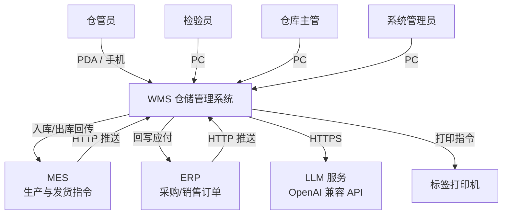
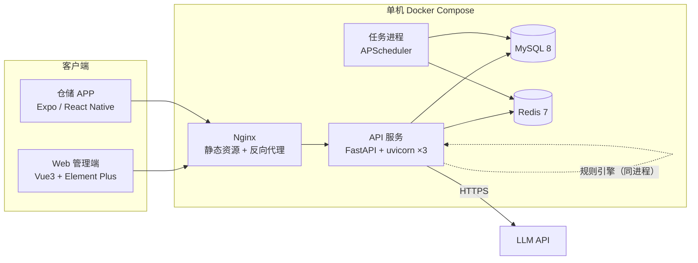
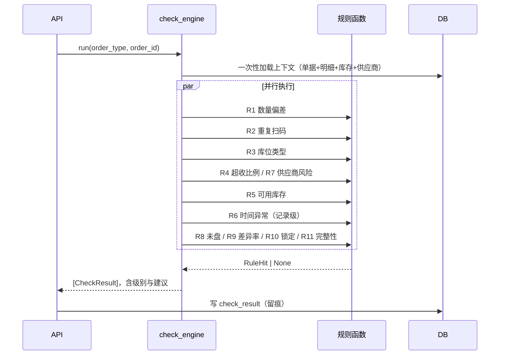
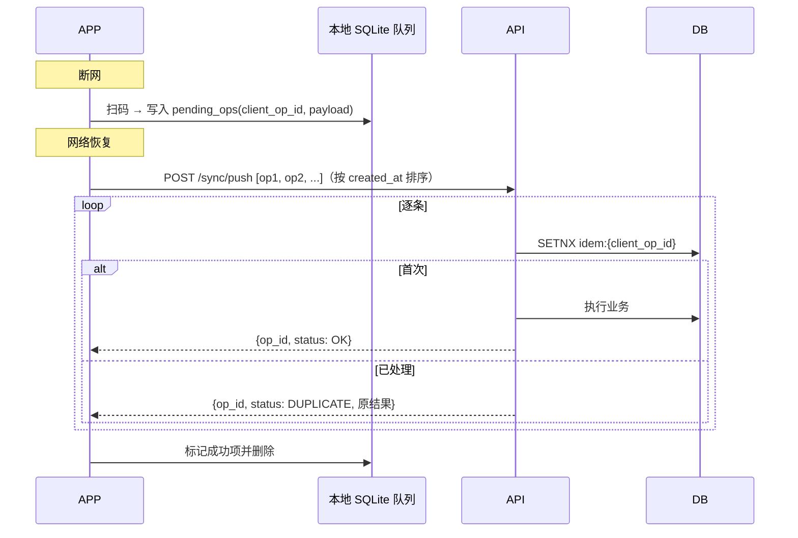
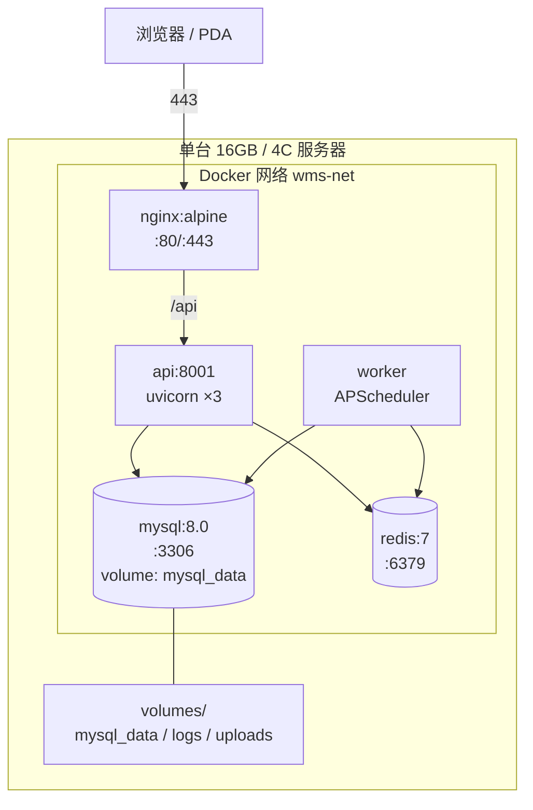

# WMS 仓储管理系统 · 架构设计文档（ADD）

| 项目 | 内容 |
|---|---|
| 文档版本 | V1.0 |
| 编写日期 | 2026-10-28 |
| 文档性质 | 开发落地用：含组件视图、接口契约、核心表 DDL、ADR |
| 上游文档 | `WMS仓储管理系统_PRD_V2.1.md`（34 屏，26 条业务规则） |
| 关联原型 | `wms-prototype-v2.1.html` |
| 规模假设 | 单工厂、200 并发、日均 800–2000 单、SKU 万级、单机部署 |

**本文档不覆盖**：监控告警细则、应急预案、灾备方案、性能压测报告（列入运维手册）。

---

## 1. 架构目标与约束

### 1.1 质量属性（按优先级排序）

| 优先级 | 属性 | 目标 | 对应 PRD 约束 |
|---|---|---|---|
| P0 | **数据正确性** | 库存永不因并发或重试而错账 | BR-001/002、12 章并发与事务 |
| P0 | **可追溯** | 任何库存变动可回放到「谁、何时、凭哪张单」 | BR-018、12 章审计 |
| P1 | 性能 | 列表 P95 < 1.5s；扫码提交 P95 < 300ms；校验 < 3s；问数首字 < 2s | 12 章非功能 |
| P1 | 可用性 | 生产时段 99.5%，单机故障可在 10 分钟内恢复 | 12 章 |
| P2 | 可维护性 | 新人 3 天能改一个业务规则，不改动其它模块 | — |
| P2 | 可演进 | 单机 → 双机 → 集群不改业务代码 | 见第 12 章演进路线 |

### 1.2 约束条件

| 约束 | 说明 | 影响 |
|---|---|---|
| 单机部署 | 一台 16 GB 机器，Docker Compose 编排 | 不能用 K8s 特性；进程数要克制 |
| 团队规模 | 1–2 人开发 | 拒绝微服务拆分、拒绝自研框架 |
| 现有技能 | Python / TypeScript 为主 | 后端 Python，前端 Vue3，APP RN |
| 上游系统 | MES / ERP 通过 HTTP 推送 | 需幂等与对账，不能假设对方可靠 |
| AI 边界 | AI 只建议、不写数据（PRD 1.5） | 需在**权限层**而非代码层保证 |

### 1.3 关键驱动因素

架构上的重大决定都由这三条推出来：

1. **库存正确性优先于吞吐**。200 并发不构成瓶颈，但一次错账要赔几小时对账，所以选强一致（单库事务 + 行锁）而非最终一致。
2. **AI 必须是可关闭的旁路**。客户可能拒接 LLM、模型可能超时，系统必须在没有 AI 的情况下完整可用。所以 AI 是独立模块 + 只读连接，不与主流程耦合。
3. **离线是常态不是异常**。仓库现场网络不稳，扫码必须先落本地。所以写路径设计成「客户端生成操作 ID → 服务端幂等落库」，而不是「在线才允许操作」。

---

## 2. 系统上下文（C4 L1）



| 外部系统 | 交互方式 | 数据方向 | 关键约束 |
|---|---|---|---|
| MES | HTTP + JSON，我方提供回调地址 | 双向 | 幂等键 = 单据号 + 版本号 |
| ERP | HTTP + JSON | 双向 | 同上；金额由 ERP 计价 |
| LLM 服务 | HTTPS，OpenAI 兼容 | 单向请求 | 超时 3s、可整体关闭、敏感字段脱敏 |
| 标签打印机 | 浏览器/APP 调驱动或生成 PDF | 单向 | 不纳入服务端架构 |

---

## 3. 容器视图（C4 L2）



| 容器 | 技术 | 职责 | 部署单元 | 状态 |
|---|---|---|---|---|
| Web 管理端 | Vue 3 + Vite + Element Plus + Pinia | 20 个功能页 + 3 个 AI 页（X01 / X04 / X05） | 静态文件，由 Nginx 托管 | 无状态 |
| 仓储 APP | Expo (React Native) + TypeScript + SQLite | 9 个作业页（A01–A09）+ 1 个 AI 页（X02）；离线队列 | EAS Build 打包，独立分发 | 本地持久化 |
| API 服务 | FastAPI + uvicorn（3 workers） | 全部业务接口 + AI 规则引擎 | Docker 容器 | 无状态（会话在 Redis） |
| 任务进程 | APScheduler | 周度采纳率复核、每日对账、超期单据清理、AI 周报、180 天日志清理 | 同镜像，不同启动命令 | 需单实例 |
| MySQL | MySQL 8.0（InnoDB，utf8mb4） | 全部业务数据 | Docker 容器 + volume | 有状态 |
| Redis | Redis 7 | 会话、缓存、幂等键、限流 | Docker 容器 | 可丢（幂等键除外） |
| Nginx | nginx:alpine | 静态托管、反代、gzip、HTTPS 终止 | Docker 容器 | 无状态 |

**为什么 AI 规则引擎不单独成容器**：它依赖大量库存与库位数据，独立服务就要么走内部 API（多一跳 + 每跳都要鉴权），要么直连数据库（等于开了第二个写入口）。同进程 + 只读连接池能同时满足性能与隔离，且部署单元不变。详见 ADR-003。

---

## 4. 组件视图（C4 L3）

### 4.1 后端代码结构

```
app/
├── main.py                  # FastAPI 实例、中间件、路由挂载
├── core/
│   ├── config.py            # pydantic-settings，读 .env
│   ├── security.py          # JWT 签发/校验、密码哈希
│   ├── deps.py              # 依赖注入：db session、当前用户、权限
│   ├── errors.py            # 错误码与统一异常处理
│   └── logging.py           # 结构化日志（JSON）
├── api/v1/
│   ├── auth.py              # 登录、刷新、登出
│   ├── inventory.py         # 库存查询
│   ├── inbound.py           # 入库单（4 类）
│   ├── outbound.py          # 出库单（3 类）
│   ├── inspection.py        # 来料检验
│   ├── stocktake.py         # 盘点
│   ├── move.py              # 移位
│   ├── base_data.py         # 仓库/库位/条码
│   ├── supplier.py          # 供应商档案（超收阈值覆盖）
│   ├── admin.py             # 账号/角色/规则配置
│   ├── check.py             # 提交前校验（X04）
│   ├── ai.py                # 库位推荐 / 路径 / 问数 / 看板
│   ├── export.py            # 异步导出（CSV）
│   └── sync.py              # 离线补传
├── domain/
│   ├── models.py            # SQLAlchemy 模型
│   ├── enums.py             # 状态枚举、业务类型
│   ├── rules.py             # 业务规则（BR-001 ~ BR-026）
│   ├── machine.py           # 单据状态机（PRD 第 9 章，5 类单据的合法迁移表）
│   └── stock.py             # 库存增减的唯一入口
├── service/
│   ├── inbound_service.py
│   ├── outbound_service.py
│   ├── stocktake_service.py
│   ├── check_service.py     # 校验编排
│   └── audit_service.py     # 操作日志
├── ai/                      # ← 只能使用 readonly_session
│   ├── readonly.py          # 只读连接池 + 只读 Session
│   ├── location_advisor.py  # 库位推荐（X02）
│   ├── path_solver.py       # 路径优化（X03）
│   ├── check_engine.py      # 规则引擎（X04）
│   ├── nl_query/
│   │   ├── intent.py        # 意图分类 + 槽位抽取
│   │   ├── semantics.py     # 指标语义层
│   │   └── guard.py         # SQL 白名单校验
│   ├── llm_gateway.py       # 超时、重试、降级、脱敏
│   └── feedback.py          # 采纳/拒绝记录
├── repository/
│   └── *.py                 # 数据访问（不写业务逻辑）
└── tasks/
    ├── scheduler.py         # APScheduler 入口
    ├── adoption_review.py   # 周度采纳率复核（每周一 09:00）
    ├── reconcile.py         # 每日对账（02:00）
    └── weekly_report.py     # AI 周报（发送产品负责人）
```

### 4.2 分层职责与依赖规则

| 层 | 职责 | 允许依赖 | 禁止 |
|---|---|---|---|
| api | 参数校验、鉴权、组装响应 | service | 直接写 SQL、直接操作 model |
| service | 事务边界、业务编排 | domain、repository | 处理 HTTP 细节 |
| domain | 领域模型、规则、状态机 | — | 依赖 FastAPI、SQLAlchemy session |
| repository | 单表读写 | domain.models | 跨表业务逻辑 |
| ai | 只读计算、建议生成 | ai.readonly、repository(read) | **任何写连接** |

**强制约束**：`app/ai/` 目录下不允许 import `app.core.deps.get_db`（写会话）。用 `flake8-tidy-imports` 或 pre-commit 的 banned-api 规则卡住，不靠人记。

### 4.3 关键组件清单

| 组件 | 职责 | 复杂度 | 备注 |
|---|---|---|---|
| `domain/machine.py` | 5 类单据的状态迁移表与「终态不可回退」「作废需原因」约束 | 中 | 所有状态推进只经此处，service 不得直接赋 status |
| `domain/stock.py` | 库存增减的唯一入口，负责行锁、写流水、校验可用量 | 高 | 所有单据必须走它 |
| `service/check_service.py` | 编排 11 条规则，聚合结果 | 中 | 并行执行，3s 超时 |
| `ai/check_engine.py` | 规则注册表与执行器 | 中 | 纯函数式，无副作用 |
| `ai/location_advisor.py` | 5 维打分 + 硬约束过滤 | 中 | 冷启动权重切换 |
| `ai/path_solver.py` | 三档算法路由 | 中高 | 精确 DP / 2-opt / 聚类 |
| `ai/llm_gateway.py` | 超时、重试、降级、脱敏、限流 | 中 | 唯一的外部依赖出口 |
| `ai/nl_query/guard.py` | SQL 白名单校验 | 高 | 安全关键，需单测覆盖 |

---

## 5. 关键流程时序

### 5.1 采购入库（含 AI 推荐与校验）

```mermaid
sequenceDiagram
    participant MES
    participant API
    participant Stock as domain/stock
    participant DB
    participant AI as ai/location_advisor
    participant APP

    MES->>API: POST /integration/inspections（幂等键=单号+版本）
    API->>DB: 落检验单（待检）
    APP->>API: POST /inspections/{id}/scan（client_op_id）
    API->>DB: SETNX idem:{uuid} → 首次则继续
    API->>DB: 写扫码明细，判定结果
    API->>DB: 生成入库单（待入库）
    APP->>API: POST /ai/locations/recommend
    API->>AI: 打分（只读连接）
    AI->>DB: SELECT 同物料库位分布 / 容量 / 坐标
    AI-->>APP: Top1 + 2 备选 + 3 条理由
    APP->>API: POST /inbound-orders/{id}/submit
    API->>AI: check_engine.run()
    AI-->>API: 3 通过 / 1 预警
    API->>Stock: apply_inbound(order, items)
    Stock->>DB: BEGIN; SELECT ... FOR UPDATE; UPDATE inventory; INSERT txn; COMMIT
    API->>MES: 入库完成回传（异步重试）
```

### 5.2 库存扣减（唯一写入口）

所有入库、出库、盘盈盘亏、移位都收敛到 `stock.apply()`，伪代码：

```python
def apply(session, *, sku_type, sku_id, location_id, delta, biz_type, biz_no, operator):
    # 1) 行锁：多条库存时按 inventory.id 升序加锁，防死锁
    inv = session.execute(
        select(Inventory)
        .where(Inventory.sku_type == sku_type,
               Inventory.sku_id == sku_id,
               Inventory.location_id == location_id)
        .with_for_update()
    ).scalar_one_or_none()

    if inv is None:
        if delta < 0:
            raise BusinessError("WMS-4221", "该库位无此物料库存")
        inv = Inventory(...); session.add(inv); session.flush()
        # 新行同样加锁，避免并发插入重复
        session.execute(select(Inventory).where(Inventory.id == inv.id).with_for_update())

    available = inv.qty - inv.locked_qty - inv.frozen_qty
    if delta < 0 and available + delta < 0:
        raise BusinessError("WMS-4222", f"可用库存不足，缺口 {abs(available + delta)}")

    inv.qty += delta
    before = inv.qty - delta
    session.add(Txn(sku_type=..., qty_delta=delta, balance=inv.qty,
                    biz_type=biz_type, biz_no=biz_no, operator=operator))
    return inv
```

**要点**
- 事务边界由 service 层控制，`apply()` 只做单步，不 commit。
- 始终按 `inventory.id` 升序加锁（多物料单据一次锁多行时），避免交叉死锁。
- 死锁重试：捕获 `OperationalError(1213)`，最多重试 3 次，退避 50/100/200ms。
- 不允许任何地方直接 `UPDATE inventory`，用 lint 规则 + code review 双保险。

### 5.3 提交前校验（11 条规则）



**性能设计**
- 上下文一次查完（3–4 条 SQL），不做 N+1。
- 规则函数纯计算，无 IO；需要额外数据的规则在上下文里预取。
- 用 `asyncio.gather` + `asyncio.wait_for(3s)`；超时的规则标记 `TIMEOUT` 并降级为「未校验」，不阻断。
- 结果缓存：`check:{order_type}:{order_id}:{version}` 存 Redis 5 分钟，重复提交直接命中。

### 5.4 离线补传



**冲突处理**

| 冲突 | 服务端返回 | APP 行为 |
|---|---|---|
| 单据已关闭 / 已作废 | `WMS-4092 ORDER_CLOSED` | 该条标红，提示「单据已关闭，扫码无效」 |
| 库存不足 | `WMS-4222 STOCK_SHORT` | 提示改量或转人工 |
| 箱码重复 | `WMS-4093 DUPLICATE_BOX` | 允许跳过，不阻断后续 |
| 版本冲突（乐观锁） | `WMS-4094 VERSION_CONFLICT` | 拉取最新单据状态后重试一次 |

**关键点**：`client_op_id` 由客户端生成（UUID v4），**不是**服务端编号。这样重放任意次结果一致，也不依赖单据是否存在。

### 5.5 智能问数

```text
用户问题
  → intent.py：LLM 分类（库存/流水/对比/排名/单据/口径）+ 槽位（SKU、时间、仓库）
  → semantics.py：指标名 → SQL 模板 + 参数绑定（白名单）
  → guard.py：只允许 SELECT；强制加 tenant/warehouse 过滤；LIMIT 5000
  → 只读连接执行
  → LLM 组织话术（结论 + 口径说明）
```

**降级**：LLM 超时 → 只返回数据表 + 模板文案「已为你查到以下数据」；LLM 不可用 → 隐藏入口（BR-020）。

---

## 6. 数据架构

### 6.1 数据库选型

选 **MySQL 8.0** 而非 PostgreSQL：团队更熟、国内运维资料多、云厂商托管普遍。代价是没有 `RETURNING` 与部分窗口函数便利，用 `LAST_INSERT_ID()` 与子查询替代。

字符集 `utf8mb4`，排序规则 `utf8mb4_0900_ai_ci`，引擎 InnoDB，时区统一存 UTC。

### 6.2 核心表 DDL

> **单一数据源原则**：所有表的 DDL 只在本节定义，PRD 10.2 的实体清单是需求视角的字段说明，建表以本节为准；两处若出现差异，改本节并同步 PRD。共 26 张表，按「主数据 → 账号权限 → 单据 → 库存 → AI → 运维」分组。

**主数据**

```sql
CREATE TABLE warehouse (
  id        BIGINT UNSIGNED PRIMARY KEY AUTO_INCREMENT,
  code      VARCHAR(32)  NOT NULL COMMENT 'WH-001',
  name      VARCHAR(64)  NOT NULL,
  type      ENUM('MATERIAL','PRODUCT','AUX','SLOW') NOT NULL COMMENT '原料/成品/辅料/呆滞',
  status    ENUM('ENABLED','DISABLED') NOT NULL DEFAULT 'ENABLED',
  owner_id  BIGINT UNSIGNED NULL COMMENT '负责人',
  created_at DATETIME NOT NULL DEFAULT CURRENT_TIMESTAMP,
  UNIQUE KEY uk_code (code)
) ENGINE=InnoDB DEFAULT CHARSET=utf8mb4 COMMENT='仓库';

CREATE TABLE supplier (
  id             BIGINT UNSIGNED PRIMARY KEY AUTO_INCREMENT,
  code           VARCHAR(32)  NOT NULL COMMENT 'GYS-ZTE-001',
  name           VARCHAR(128) NOT NULL,
  over_receive   DECIMAL(5,2) NULL COMMENT '超收阈值覆盖值，NULL=用全局默认（BR-023）',
  contact        VARCHAR(64)  NULL,
  status         ENUM('ENABLED','DISABLED') NOT NULL DEFAULT 'ENABLED',
  created_at     DATETIME NOT NULL DEFAULT CURRENT_TIMESTAMP,
  UNIQUE KEY uk_code (code)
) ENGINE=InnoDB DEFAULT CHARSET=utf8mb4 COMMENT='供应商档案';

CREATE TABLE material (
  id           BIGINT UNSIGNED PRIMARY KEY AUTO_INCREMENT,
  code         VARCHAR(64)  NOT NULL COMMENT 'BAT-LIPO-4500-003',
  name         VARCHAR(128) NOT NULL,
  type         VARCHAR(32)  NOT NULL COMMENT '原料/辅件',
  unit         VARCHAR(16)  NOT NULL,
  safety_stock INT NOT NULL DEFAULT 0,
  weight_kg    DECIMAL(10,3) NULL COMMENT '属性完整率统计字段（Gate G2）',
  volume_m3    DECIMAL(10,6) NULL,
  is_dangerous TINYINT(1) NOT NULL DEFAULT 0,
  temp_control ENUM('NONE','CONSTANT','COLD') NOT NULL DEFAULT 'NONE',
  created_at   DATETIME NOT NULL DEFAULT CURRENT_TIMESTAMP,
  UNIQUE KEY uk_code (code)
) ENGINE=InnoDB DEFAULT CHARSET=utf8mb4 COMMENT='物料';

CREATE TABLE product (
  id         BIGINT UNSIGNED PRIMARY KEY AUTO_INCREMENT,
  code       VARCHAR(64)  NOT NULL COMMENT 'A3288',
  name       VARCHAR(128) NOT NULL,
  spec       VARCHAR(255) NULL COMMENT '尺寸/屏幕/分辨率/亮度，多行文本',
  unit       VARCHAR(16)  NOT NULL DEFAULT '台',
  weight_kg  DECIMAL(10,3) NULL,
  volume_m3  DECIMAL(10,6) NULL,
  is_dangerous TINYINT(1) NOT NULL DEFAULT 0,
  temp_control ENUM('NONE','CONSTANT','COLD') NOT NULL DEFAULT 'NONE',
  created_at DATETIME NOT NULL DEFAULT CURRENT_TIMESTAMP,
  UNIQUE KEY uk_code (code)
) ENGINE=InnoDB DEFAULT CHARSET=utf8mb4 COMMENT='产品';

CREATE TABLE barcode (
  id         BIGINT UNSIGNED PRIMARY KEY AUTO_INCREMENT,
  code       VARCHAR(64) NOT NULL COMMENT 'KQ-001',
  type       ENUM('ZONE','LOCATION','MATERIAL','BOX') NOT NULL,
  ref_id     BIGINT UNSIGNED NULL COMMENT '关联的库位/物料ID',
  created_at DATETIME NOT NULL DEFAULT CURRENT_TIMESTAMP,
  UNIQUE KEY uk_code (code)
) ENGINE=InnoDB DEFAULT CHARSET=utf8mb4 COMMENT='条码（全局唯一，BR-009）';
```

**账号与权限（PRD 3.2 的 5 角色 × 14 功能矩阵）**

```sql
CREATE TABLE user (
  id          BIGINT UNSIGNED PRIMARY KEY AUTO_INCREMENT,
  username    VARCHAR(32)  NOT NULL,
  password    VARCHAR(100) NOT NULL COMMENT 'bcrypt cost=12',
  name        VARCHAR(64)  NOT NULL,
  phone       VARCHAR(20)  NULL COMMENT '日志中掩码',
  role        ENUM('KEEPER','INSPECTOR','SUPERVISOR','ADMIN','INTEGRATION') NOT NULL,
  status      ENUM('ENABLED','DISABLED') NOT NULL DEFAULT 'ENABLED',
  fail_count  TINYINT NOT NULL DEFAULT 0 COMMENT '连续密码错误次数',
  locked_until DATETIME NULL COMMENT '锁定到期时间（5 次错锁 10 分钟）',
  created_at  DATETIME NOT NULL DEFAULT CURRENT_TIMESTAMP,
  UNIQUE KEY uk_username (username)
) ENGINE=InnoDB DEFAULT CHARSET=utf8mb4 COMMENT='账号';

-- 数据权限：用户可见仓库范围，问数与库存查询在依赖注入层强制注入（9.3）
CREATE TABLE user_warehouse (
  user_id     BIGINT UNSIGNED NOT NULL,
  warehouse_id BIGINT UNSIGNED NOT NULL,
  PRIMARY KEY (user_id, warehouse_id)
) ENGINE=InnoDB DEFAULT CHARSET=utf8mb4 COMMENT='用户-仓库数据权限';

-- 集成账号（MES/ERP）的接口级令牌，与用户表的 JWT 分离
CREATE TABLE api_client (
  id        BIGINT UNSIGNED PRIMARY KEY AUTO_INCREMENT,
  app_key   VARCHAR(32)  NOT NULL,
  app_secret VARCHAR(100) NOT NULL,
  name      VARCHAR(64)  NOT NULL COMMENT 'MES / ERP',
  source    ENUM('MES','ERP') NOT NULL,
  status    ENUM('ENABLED','DISABLED') NOT NULL DEFAULT 'ENABLED',
  created_at DATETIME NOT NULL DEFAULT CURRENT_TIMESTAMP,
  UNIQUE KEY uk_key (app_key)
) ENGINE=InnoDB DEFAULT CHARSET=utf8mb4 COMMENT='集成账号';
```

**库位（AI 推荐的基础，坐标必填由 Gate G1 保证）**

```sql
CREATE TABLE location (
  id            BIGINT UNSIGNED PRIMARY KEY AUTO_INCREMENT,
  code          VARCHAR(32)  NOT NULL COMMENT '库位编码 A1-01-01',
  name          VARCHAR(64)  NOT NULL,
  type          ENUM('NORMAL','STEREO','CONSTANT_TEMP','DANGEROUS') NOT NULL DEFAULT 'NORMAL',
  warehouse_id  BIGINT UNSIGNED NOT NULL,
  cap_pallet    INT NOT NULL DEFAULT 0,
  cap_material  INT NOT NULL DEFAULT 0,
  used_pallet   INT NOT NULL DEFAULT 0,
  status        ENUM('IDLE','OCCUPIED','LOCKED','MAINTAIN') NOT NULL DEFAULT 'IDLE',
  coord_x       DECIMAL(8,2) NULL COMMENT '货架列坐标',
  coord_y       DECIMAL(8,2) NULL COMMENT '货架行坐标',
  dist_to_dock  DECIMAL(8,2) NULL COMMENT '到装卸台距离(米)',
  dist_to_pack  DECIMAL(8,2) NULL COMMENT '到打包台距离(米)',
  created_at    DATETIME NOT NULL DEFAULT CURRENT_TIMESTAMP,
  updated_at    DATETIME NOT NULL DEFAULT CURRENT_TIMESTAMP ON UPDATE CURRENT_TIMESTAMP,
  UNIQUE KEY uk_code (code),
  KEY idx_wh_status (warehouse_id, status)
) ENGINE=InnoDB DEFAULT CHARSET=utf8mb4 COMMENT='库位';
```

**库存（唯一会并发写的表）**

```sql
CREATE TABLE inventory (
  id          BIGINT UNSIGNED PRIMARY KEY AUTO_INCREMENT,
  sku_type    ENUM('PRODUCT','MATERIAL') NOT NULL,
  sku_id      BIGINT UNSIGNED NOT NULL,
  location_id BIGINT UNSIGNED NOT NULL,
  qty         INT NOT NULL DEFAULT 0 COMMENT '物理库存',
  locked_qty  INT NOT NULL DEFAULT 0 COMMENT '锁定(已分配未出库)',
  frozen_qty  INT NOT NULL DEFAULT 0 COMMENT '冻结(质检/盘点)',
  updated_at  DATETIME NOT NULL DEFAULT CURRENT_TIMESTAMP ON UPDATE CURRENT_TIMESTAMP,
  UNIQUE KEY uk_sku_loc (sku_type, sku_id, location_id),
  KEY idx_loc (location_id)
) ENGINE=InnoDB DEFAULT CHARSET=utf8mb4 COMMENT='库存';
-- 可用量 = qty - locked_qty - frozen_qty，不落库，避免三处不一致
```

**入库单 / 明细**

```sql
CREATE TABLE inbound_order (
  id          BIGINT UNSIGNED PRIMARY KEY AUTO_INCREMENT,
  no          VARCHAR(32) NOT NULL COMMENT 'PI/PR/RT/SG + yyyyMMdd + 3位流水',
  type        ENUM('PRODUCT','PURCHASE','RETURN','GAIN') NOT NULL,
  source_no   VARCHAR(32) NULL COMMENT '生产任务单/检验单/盘点单',
  supplier_id BIGINT UNSIGNED NULL COMMENT '采购入库时必填，R7 供应商风险依赖',
  status      ENUM('PENDING','PARTIAL','DONE','VOID') NOT NULL DEFAULT 'PENDING',
  plan_qty    INT NOT NULL DEFAULT 0,
  actual_qty  INT NOT NULL DEFAULT 0,
  config_snapshot JSON NULL COMMENT '创建时的配置快照（超收/偏差阈值等），BR-026',
  version     INT NOT NULL DEFAULT 0 COMMENT '乐观锁',
  creator_id  BIGINT UNSIGNED NOT NULL,
  checker_id  BIGINT UNSIGNED NULL,
  created_at  DATETIME NOT NULL DEFAULT CURRENT_TIMESTAMP,
  finished_at DATETIME NULL,
  UNIQUE KEY uk_no (no),
  KEY idx_status_created (status, created_at),
  KEY idx_source (source_no),
  KEY idx_supplier (supplier_id)
) ENGINE=InnoDB DEFAULT CHARSET=utf8mb4 COMMENT='入库单';

CREATE TABLE inbound_item (
  id          BIGINT UNSIGNED PRIMARY KEY AUTO_INCREMENT,
  order_id    BIGINT UNSIGNED NOT NULL,
  sku_id      BIGINT UNSIGNED NOT NULL,
  box_code    VARCHAR(64) NULL,
  sn          VARCHAR(64) NULL,
  qty         INT NOT NULL DEFAULT 0,
  location_id BIGINT UNSIGNED NULL,
  KEY idx_order (order_id),
  KEY idx_box (box_code),
  KEY idx_sn (sn)
) ENGINE=InnoDB DEFAULT CHARSET=utf8mb4 COMMENT='入库明细';
```

**库存流水（只增不删，审计与问数的数据源）**

```sql
CREATE TABLE txn (
  id          BIGINT UNSIGNED PRIMARY KEY AUTO_INCREMENT,
  sku_type    ENUM('PRODUCT','MATERIAL') NOT NULL,
  sku_id      BIGINT UNSIGNED NOT NULL,
  location_id BIGINT UNSIGNED NOT NULL,
  qty_delta   INT NOT NULL COMMENT '正入负出',
  balance     INT NOT NULL COMMENT '事务后结存',
  biz_type    VARCHAR(24) NOT NULL COMMENT 'PURCHASE_IN/SALES_OUT/...',
  biz_no      VARCHAR(32) NOT NULL,
  operator_id BIGINT UNSIGNED NOT NULL,
  created_at  DATETIME NOT NULL DEFAULT CURRENT_TIMESTAMP,
  KEY idx_sku_time (sku_type, sku_id, created_at),
  KEY idx_biz (biz_no),
  KEY idx_time (created_at)
) ENGINE=InnoDB DEFAULT CHARSET=utf8mb4 COMMENT='库存流水';
-- 不设 UPDATE/DELETE 权限给应用账号，从权限层保证"只增不删"
```

**来料检验 / 盘点 / 移位**

```sql
CREATE TABLE inspection (
  id           BIGINT UNSIGNED PRIMARY KEY AUTO_INCREMENT,
  no           VARCHAR(32) NOT NULL COMMENT 'JY + yyyyMMdd + 3位流水',
  supplier_id  BIGINT UNSIGNED NOT NULL,
  logistics_no VARCHAR(64) NULL COMMENT '物流单号',
  plate_no     VARCHAR(32) NULL COMMENT '运输车牌号',
  status       ENUM('PENDING','CHECKING','DONE') NOT NULL DEFAULT 'PENDING',
  result       ENUM('PASS','PARTIAL','OVER_PASS','FAIL') NULL COMMENT '合格/部分合格/合格(超收)/不合格',
  plan_qty     INT NOT NULL DEFAULT 0,
  actual_qty   INT NOT NULL DEFAULT 0,
  fail_reason  VARCHAR(255) NULL COMMENT '不合格必填，计入供应商质量档案',
  creator_id   BIGINT UNSIGNED NOT NULL,
  created_at   DATETIME NOT NULL DEFAULT CURRENT_TIMESTAMP,
  checked_at   DATETIME NULL,
  version      INT NOT NULL DEFAULT 0,
  UNIQUE KEY uk_no (no),
  KEY idx_supplier_time (supplier_id, created_at),
  KEY idx_status (status)
) ENGINE=InnoDB DEFAULT CHARSET=utf8mb4 COMMENT='来料检验单';

CREATE TABLE inspection_item (
  id            BIGINT UNSIGNED PRIMARY KEY AUTO_INCREMENT,
  inspection_id BIGINT UNSIGNED NOT NULL,
  material_id   BIGINT UNSIGNED NOT NULL,
  plan_qty      INT NOT NULL DEFAULT 0,
  actual_qty    INT NOT NULL DEFAULT 0,
  barcode       VARCHAR(64) NULL,
  qualified     TINYINT(1) NULL COMMENT 'NULL=未判定',
  KEY idx_inspection (inspection_id)
) ENGINE=InnoDB DEFAULT CHARSET=utf8mb4 COMMENT='检验明细';

CREATE TABLE stocktake (
  id           BIGINT UNSIGNED PRIMARY KEY AUTO_INCREMENT,
  no           VARCHAR(32) NOT NULL COMMENT 'PD + yyyyMMdd + 3位流水',
  type         ENUM('FULL','SPOT','CYCLE') NOT NULL COMMENT '全盘/抽盘/循环盘点',
  warehouse_id BIGINT UNSIGNED NOT NULL,
  mode         ENUM('BLIND','OPEN') NOT NULL DEFAULT 'BLIND' COMMENT '创建时固化不可改（BR-024）',
  status       ENUM('PENDING','COUNTING','CONFIRMING','DONE','CANCELED') NOT NULL DEFAULT 'PENDING',
  total        INT NOT NULL DEFAULT 0 COMMENT '应盘库位数',
  done         INT NOT NULL DEFAULT 0,
  diff_loss    INT NOT NULL DEFAULT 0 COMMENT '盘亏条目数',
  diff_gain    INT NOT NULL DEFAULT 0,
  operator_id  BIGINT UNSIGNED NOT NULL,
  created_at   DATETIME NOT NULL DEFAULT CURRENT_TIMESTAMP,
  finished_at  DATETIME NULL,
  version      INT NOT NULL DEFAULT 0,
  UNIQUE KEY uk_no (no),
  KEY idx_wh_status (warehouse_id, status)
) ENGINE=InnoDB DEFAULT CHARSET=utf8mb4 COMMENT='盘点单';

CREATE TABLE stocktake_item (
  id           BIGINT UNSIGNED PRIMARY KEY AUTO_INCREMENT,
  stocktake_id BIGINT UNSIGNED NOT NULL,
  material_id  BIGINT UNSIGNED NOT NULL,
  location_id  BIGINT UNSIGNED NOT NULL,
  book_qty     INT NOT NULL DEFAULT 0 COMMENT '账面（盲盘对操作员不可见）',
  real_qty     INT NULL COMMENT 'NULL=未盘，差异只在有值时计算',
  KEY idx_stocktake (stocktake_id),
  UNIQUE KEY uk_st_loc (stocktake_id, location_id, material_id)
) ENGINE=InnoDB DEFAULT CHARSET=utf8mb4 COMMENT='盘点明细';

CREATE TABLE move_order (
  id          BIGINT UNSIGNED PRIMARY KEY AUTO_INCREMENT,
  no          VARCHAR(32) NOT NULL COMMENT 'YK + yyyyMMdd + 3位流水',
  material_id BIGINT UNSIGNED NOT NULL,
  from_loc_id BIGINT UNSIGNED NOT NULL,
  to_loc_id   BIGINT UNSIGNED NOT NULL,
  qty         INT NOT NULL,
  status      ENUM('PENDING','DOING','DONE') NOT NULL DEFAULT 'PENDING',
  operator_id BIGINT UNSIGNED NOT NULL,
  created_at  DATETIME NOT NULL DEFAULT CURRENT_TIMESTAMP,
  finished_at DATETIME NULL,
  UNIQUE KEY uk_no (no),
  KEY idx_from (from_loc_id, status)
) ENGINE=InnoDB DEFAULT CHARSET=utf8mb4 COMMENT='移位单';
```

**AI 建议与反馈**

```sql
CREATE TABLE ai_suggestion (
  id          BIGINT UNSIGNED PRIMARY KEY AUTO_INCREMENT,
  trace_id    CHAR(32) NOT NULL COMMENT '回放用，贯穿日志',
  type        ENUM('LOCATION','PATH','CHECK') NOT NULL,
  target_id   BIGINT UNSIGNED NOT NULL COMMENT '单据ID或任务ID',
  payload     JSON NOT NULL COMMENT '打分输入与结果',
  score       DECIMAL(6,2) NULL,
  reasons     JSON NULL COMMENT '3条理由',
  created_at  DATETIME NOT NULL DEFAULT CURRENT_TIMESTAMP,
  UNIQUE KEY uk_trace (trace_id),
  KEY idx_type_time (type, created_at)
) ENGINE=InnoDB DEFAULT CHARSET=utf8mb4 COMMENT='AI建议记录';

CREATE TABLE ai_feedback (
  id            BIGINT UNSIGNED PRIMARY KEY AUTO_INCREMENT,
  suggestion_id BIGINT UNSIGNED NOT NULL,
  action        ENUM('ACCEPT','REJECT','REVOKE') NOT NULL,
  reason        VARCHAR(64) NULL COMMENT '不合适/不信任/太慢',
  operator_id   BIGINT UNSIGNED NOT NULL,
  created_at    DATETIME NOT NULL DEFAULT CURRENT_TIMESTAMP,
  KEY idx_sug (suggestion_id),
  KEY idx_time (created_at)
) ENGINE=InnoDB DEFAULT CHARSET=utf8mb4 COMMENT='建议反馈';

-- 结果指标埋点：X05 看板「找位时长 / 拣货行走距离」的唯一数据源（PRD 14.2）
-- 没有这张表，X05 的结果指标区块只能空着
CREATE TABLE metric_event (
  id          BIGINT UNSIGNED PRIMARY KEY AUTO_INCREMENT,
  scene       ENUM('LOCATE','PICK','CHECK','QUERY') NOT NULL COMMENT '找位/拣货/校验/问数',
  trace_id    CHAR(32) NOT NULL,
  order_type  VARCHAR(16) NULL,
  order_id    BIGINT UNSIGNED NULL,
  user_id     BIGINT UNSIGNED NOT NULL,
  duration_ms INT NULL COMMENT '扫码→确认库位 / 拣货任务开始→完成',
  distance_m  DECIMAL(10,2) NULL COMMENT 'AI 建议距离（基线 = 默认顺序距离）',
  baseline_m  DECIMAL(10,2) NULL,
  ai_used     TINYINT(1) NOT NULL DEFAULT 0 COMMENT '1=本次走了 AI 建议',
  created_at  DATETIME NOT NULL DEFAULT CURRENT_TIMESTAMP,
  KEY idx_scene_time (scene, created_at),
  KEY idx_trace (trace_id),
  KEY idx_order (order_type, order_id)
) ENGINE=InnoDB DEFAULT CHARSET=utf8mb4 COMMENT='AI 结果指标埋点';
```

**操作日志与幂等**

```sql
CREATE TABLE op_log (
  id          BIGINT UNSIGNED PRIMARY KEY AUTO_INCREMENT,
  client_op_id CHAR(36) NOT NULL COMMENT '客户端生成的 UUID',
  user_id     BIGINT UNSIGNED NULL,
  path        VARCHAR(120) NOT NULL,
  result      JSON NULL COMMENT '首次执行的结果，重放时原样返回',
  created_at  DATETIME NOT NULL DEFAULT CURRENT_TIMESTAMP,
  UNIQUE KEY uk_client_op (client_op_id),
  KEY idx_time (created_at)
) ENGINE=InnoDB DEFAULT CHARSET=utf8mb4 COMMENT='幂等与审计';
```

**系统配置（对应 PRD 6.9 的 10 个配置项）**

```sql
CREATE TABLE sys_config (
  id          BIGINT UNSIGNED PRIMARY KEY AUTO_INCREMENT,
  cfg_key     VARCHAR(64) NOT NULL COMMENT 'over_receive_ratio / stocktake_mode / ai_enabled ...',
  cfg_value   VARCHAR(255) NOT NULL,
  value_type  ENUM('INT','DECIMAL','BOOL','ENUM','STRING') NOT NULL,
  scope       ENUM('GLOBAL','SUPPLIER') NOT NULL DEFAULT 'GLOBAL',
  scope_id    BIGINT UNSIGNED NULL COMMENT 'scope=SUPPLIER 时为供应商ID',
  remark      VARCHAR(255) NULL,
  updated_by  BIGINT UNSIGNED NULL,
  updated_at  DATETIME NOT NULL DEFAULT CURRENT_TIMESTAMP ON UPDATE CURRENT_TIMESTAMP,
  UNIQUE KEY uk_key_scope (cfg_key, scope, scope_id)
) ENGINE=InnoDB DEFAULT CHARSET=utf8mb4 COMMENT='系统配置';
-- 读取顺序：scope=SUPPLIER 命中则用，否则回落 GLOBAL
```

**出库单 / 明细（与入库侧对称，出库是核心写路径）**

```sql
CREATE TABLE outbound_order (
  id          BIGINT UNSIGNED PRIMARY KEY AUTO_INCREMENT,
  no          VARCHAR(32) NOT NULL COMMENT 'SO/PL/SL + yyyyMMdd + 3位流水',
  type        ENUM('SALES','PICK','LOSS') NOT NULL,
  source_no   VARCHAR(32) NULL COMMENT '销售订单/领料需求/盘点单',
  status      ENUM('PENDING','PARTIAL','DONE','VOID') NOT NULL DEFAULT 'PENDING',
  plan_qty    INT NOT NULL DEFAULT 0,
  actual_qty  INT NOT NULL DEFAULT 0,
  config_snapshot JSON NULL COMMENT '创建时的配置快照，BR-026',
  version     INT NOT NULL DEFAULT 0 COMMENT '乐观锁',
  creator_id  BIGINT UNSIGNED NOT NULL,
  created_at  DATETIME NOT NULL DEFAULT CURRENT_TIMESTAMP,
  finished_at DATETIME NULL,
  UNIQUE KEY uk_no (no),
  KEY idx_status_created (status, created_at),
  KEY idx_source (source_no)
) ENGINE=InnoDB DEFAULT CHARSET=utf8mb4 COMMENT='出库单';

CREATE TABLE outbound_item (
  id          BIGINT UNSIGNED PRIMARY KEY AUTO_INCREMENT,
  order_id    BIGINT UNSIGNED NOT NULL,
  sku_id      BIGINT UNSIGNED NOT NULL,
  sn          VARCHAR(64) NULL,
  location_id BIGINT UNSIGNED NULL,
  status      ENUM('PENDING','PICKED','SHIPPED') NOT NULL DEFAULT 'PENDING',
  operator_id BIGINT UNSIGNED NULL,
  operated_at DATETIME NULL,
  KEY idx_order (order_id),
  KEY idx_sn (sn)
) ENGINE=InnoDB DEFAULT CHARSET=utf8mb4 COMMENT='出库明细';
```

**校验结果（X04 留痕，BR-018 要求留存 ≥ 180 天）**

```sql
CREATE TABLE check_result (
  id           BIGINT UNSIGNED PRIMARY KEY AUTO_INCREMENT,
  trace_id     CHAR(32) NOT NULL,
  order_type   ENUM('INBOUND','OUTBOUND','STOCKTAKE') NOT NULL,
  order_id     BIGINT UNSIGNED NOT NULL,
  rules        JSON NOT NULL COMMENT '命中规则明细 [{rule, level, title, detail}]',
  summary      JSON NOT NULL COMMENT '{pass, warn, block, timeout}',
  status       ENUM('PASS','SUBMITTED_WITH_WARN','BLOCKED') NOT NULL,
  reason       VARCHAR(255) NULL COMMENT '带预警提交时必填（BR-016，≥5字）',
  version      INT NOT NULL DEFAULT 0 COMMENT '单据版本，缓存键的一部分',
  elapsed_ms   INT NOT NULL,
  created_at   DATETIME NOT NULL DEFAULT CURRENT_TIMESTAMP,
  KEY idx_order (order_type, order_id, version),
  KEY idx_trace (trace_id),
  KEY idx_time (created_at)
) ENGINE=InnoDB DEFAULT CHARSET=utf8mb4 COMMENT='提交前校验结果';
```

**LLM 用量与问数日志（成本核算与效果评估）**

```sql
CREATE TABLE llm_usage (
  id            BIGINT UNSIGNED PRIMARY KEY AUTO_INCREMENT,
  trace_id      CHAR(32) NOT NULL,
  scene         ENUM('QUERY','CHECK_REASON') NOT NULL COMMENT '问数 / 校验归因话术',
  model         VARCHAR(64) NOT NULL,
  prompt_tokens INT NOT NULL DEFAULT 0,
  output_tokens INT NOT NULL DEFAULT 0,
  latency_ms    INT NOT NULL,
  degraded      TINYINT(1) NOT NULL DEFAULT 0 COMMENT '1=超时降级为模板文案',
  created_at    DATETIME NOT NULL DEFAULT CURRENT_TIMESTAMP,
  KEY idx_scene_time (scene, created_at),
  KEY idx_trace (trace_id)
) ENGINE=InnoDB DEFAULT CHARSET=utf8mb4 COMMENT='LLM 调用用量';

CREATE TABLE nl_query_log (
  id           BIGINT UNSIGNED PRIMARY KEY AUTO_INCREMENT,
  trace_id     CHAR(32) NOT NULL,
  user_id      BIGINT UNSIGNED NOT NULL,
  question     VARCHAR(255) NOT NULL,
  intent       VARCHAR(32) NULL COMMENT '库存/流水/对比/排名/单据/口径',
  metric       VARCHAR(64) NULL COMMENT '命中的语义层指标名，NULL=未命中',
  generated_sql TEXT NULL,
  row_count    INT NOT NULL DEFAULT 0,
  elapsed_ms   INT NOT NULL,
  rejected     TINYINT(1) NOT NULL DEFAULT 0 COMMENT '1=被 guard 白名单拒绝',
  created_at   DATETIME NOT NULL DEFAULT CURRENT_TIMESTAMP,
  KEY idx_user_time (user_id, created_at),
  KEY idx_metric (metric),
  KEY idx_time (created_at)
) ENGINE=InnoDB DEFAULT CHARSET=utf8mb4 COMMENT='问数日志（未命中项按周补模板）';
```

**对账差异（每日 02:00 跑批产出）**

```sql
CREATE TABLE reconcile_diff (
  id          BIGINT UNSIGNED PRIMARY KEY AUTO_INCREMENT,
  biz_date    DATE NOT NULL COMMENT '对账业务日期',
  direction   ENUM('MES','ERP') NOT NULL,
  biz_no      VARCHAR(32) NOT NULL,
  diff_type   ENUM('STATUS','QTY','MISSING','EXTRA') NOT NULL,
  local_val   VARCHAR(128) NULL,
  remote_val  VARCHAR(128) NULL,
  resolved    TINYINT(1) NOT NULL DEFAULT 0,
  created_at  DATETIME NOT NULL DEFAULT CURRENT_TIMESTAMP,
  UNIQUE KEY uk_biz (biz_date, direction, biz_no, diff_type),
  KEY idx_unresolved (resolved, created_at)
) ENGINE=InnoDB DEFAULT CHARSET=utf8mb4 COMMENT='对账差异';
```

**在途库存（ERP 采购订单推送，只读）**

```sql
CREATE TABLE in_transit (
  id         BIGINT UNSIGNED PRIMARY KEY AUTO_INCREMENT,
  sku_type   ENUM('PRODUCT','MATERIAL') NOT NULL,
  sku_id     BIGINT UNSIGNED NOT NULL,
  po_no      VARCHAR(32) NOT NULL COMMENT 'ERP 采购订单号',
  qty        INT NOT NULL DEFAULT 0,
  eta        DATE NULL COMMENT '预计到货日',
  updated_at DATETIME NOT NULL DEFAULT CURRENT_TIMESTAMP ON UPDATE CURRENT_TIMESTAMP,
  UNIQUE KEY uk_po_sku (po_no, sku_type, sku_id),
  KEY idx_sku (sku_type, sku_id)
) ENGINE=InnoDB DEFAULT CHARSET=utf8mb4 COMMENT='在途库存（不参与可用量计算）';
```

> 其余主数据表（`warehouse` / `material` / `product` / `inspection` / `stocktake` / `stocktake_item` / `move_order` / `barcode`）的字段以 PRD 10.2 为准，本表只列与并发写、AI 隔离、审计对账直接相关的表。

### 6.3 索引与查询策略

| 场景 | 索引 | 说明 |
|---|---|---|
| 库存查询按 SKU | `uk_sku_loc` 前缀 | 覆盖 `sku_type + sku_id` |
| 单据列表按状态 + 时间 | `idx_status_created` | 列表默认按时间倒序 + 状态过滤 |
| 流水按 SKU + 时间 | `idx_sku_time` | 问数与详情都走它 |
| 箱码/SN 查重 | `idx_box` / `idx_sn` | R2 规则依赖 |
| 对账按单据号 | `idx_biz` | 每日对账任务 |

**分页**：一律 `LIMIT/OFFSET`，`page_size` 上限 100。超过 1 万行的导出走异步任务生成 CSV，不阻塞请求。

### 6.4 缓存策略

| Key | 类型 | TTL | 用途 |
|---|---|---|---|
| `sess:{jwt_id}` | String | 2h（滑动，8h 无操作作废） | 会话与强制下线黑名单 |
| `idem:{client_op_id}` | String | 24h | 幂等去重（DB 二次兜底） |
| `check:{type}:{id}:{ver}` | String(JSON) | 5min | 校验结果缓存 |
| `stock:{sku_type}:{sku_id}` | Hash | 30s | 库存查询热点（允许短时不一致） |
| `rl:{user}:{bucket}` | String | 60s | LLM 调用限流 |

**原则**：只缓存「可重算且短时不敏感」的数据。库存的写路径**不读缓存**，直接查库加锁，避免缓存与数据库不一致。

---

## 7. 接口设计

### 7.1 通用规范

| 项 | 约定 |
|---|---|
| 前缀 | `/api/v1` |
| 认证 | `Authorization: Bearer <JWT>`；access 2h（无操作 8h 强制登出）/ refresh 7d |
| 响应体 | `{ "code": 0, "message": "ok", "data": {...}, "trace_id": "..." }` |
| 错误码 | 见 7.2 |
| 分页 | `?page=1&page_size=20`，响应含 `total` |
| 幂等 | 写操作必须带 `client_op_id`（Header 或 body） |
| 时间 | ISO 8601，服务端统一 UTC，前端按本地时区展示 |

### 7.2 错误码

| 码 | HTTP | 含义 | 前端处理 |
|---|---|---|---|
| `WMS-4001` | 400 | 参数校验失败 | 高亮字段 |
| `WMS-4010` | 401 | 未登录 / token 过期 | 跳登录 |
| `WMS-4030` | 403 | 无权限（含跨仓越权） | 提示无权限 |
| `WMS-4091` | 409 | 幂等重放（非错误，返回原结果） | 视为成功 |
| `WMS-4092` | 409 | 单据已关闭/作废 | 提示并刷新 |
| `WMS-4093` | 409 | 箱码/SN 重复 | 跳过或标记 |
| `WMS-4094` | 409 | 版本冲突（乐观锁） | 拉最新重试一次 |
| `WMS-4221` | 422 | 业务规则不满足 | 展示 message |
| `WMS-4222` | 422 | 可用库存不足 | 提示缺口 |
| `WMS-4290` | 429 | 触发限流 | 退避重试 |
| `WMS-5000` | 500 | 服务端异常 | 提示稍后重试 + trace_id |

### 7.3 接口清单

**认证**

| 方法 | 路径 | 说明 |
|---|---|---|
| POST | `/auth/login` | 账号密码 + 验证码，返回 access/refresh |
| POST | `/auth/refresh` | 刷新 token |
| POST | `/auth/logout` | 作废会话（Redis 黑名单） |

**库存与单据查询**

| 方法 | 路径 | 说明 |
|---|---|---|
| GET | `/inventory/products` | 成品库存，支持 name/code/date 过滤 |
| GET | `/inventory/materials` | 物料库存，含可用/在途/安全库存 |
| GET | `/txn` | 出入库流水（product/material 二选一） |
| GET | `/inbound-orders` | 入库单列表（type: PRODUCT/PURCHASE/RETURN/GAIN） |
| GET | `/inbound-orders/{id}` | 入库详情（含明细） |
| GET | `/outbound-orders` | 出库单列表 |
| GET | `/outbound-orders/{id}` | 出库详情 |
| GET | `/inspections` | 检验单列表 |
| GET | `/inspections/{id}` | 检验单详情（含扫码明细） |
| GET | `/stocktakes` | 盘点单列表 |
| GET | `/stocktakes/{id}` | 盘点详情 |
| GET | `/stocktakes/{id}/items` | 盘点明细（应盘 / 已盘 / 差异） |
| GET | `/move-orders` | 移位单列表 |
| GET | `/move-orders/{id}` | 移位单详情 |
| GET | `/warehouses` | 仓库列表（含库位数量、阻塞项） |
| GET | `/locations` | 库位列表（按仓库 / 类型 / 状态过滤） |
| GET | `/barcodes` | 条码列表 |
| GET | `/suppliers` | 供应商档案（含超收阈值覆盖值） |
| GET | `/users` | 账号列表 |
| GET | `/roles` | 角色与权限矩阵 |
| GET | `/sys-configs` | 规则配置项（PRD 6.9 的 10 项） |
| GET | `/export/{biz}` | 异步导出（>1 万行生成 CSV，返回任务号） |

**写操作（均需 `client_op_id`）**

| 方法 | 路径 | 说明 |
|---|---|---|
| POST | `/inbound-orders/{id}/scan` | 扫码收货（追加明细） |
| POST | `/inbound-orders/{id}/submit` | 提交入库（先校验后落库） |
| POST | `/outbound-orders/{id}/pick` | 扫码拣货 |
| POST | `/outbound-orders/{id}/submit` | 提交出库 |
| POST | `/stocktakes/{id}/count` | 提交实盘数 |
| POST | `/stocktakes/{id}/submit` | 提交盘点（生成盈亏单据） |
| POST | `/move-orders` | 发起移位 |
| POST | `/inspections/{id}/scan` | 来料检验扫码（追加明细，APP 离线可入队） |
| POST | `/inspections/{id}/judge` | 检验判定 |
| POST | `/inspections/{id}/gen-inbound` | 已检合格 → 生成采购入库单 |
| POST | `/stocktakes` | 创建盘点单（创建时固化盲盘 / 明盘，BR-024） |
| POST | `/inbound-orders/{id}/void` | 作废入库单（必填原因，主管及以上） |
| POST | `/outbound-orders/{id}/void` | 作废出库单（同上） |

**基础资料维护（仅系统管理员，均需 `client_op_id`）**

| 方法 | 路径 | 说明 |
|---|---|---|
| POST | `/warehouses` | 新增仓库 |
| PUT | `/warehouses/{id}` | 编辑仓库 |
| POST | `/warehouses/{id}/toggle` | 启用 / 停用（停用前校验库存为 0 且无未结单据，BR-014） |
| POST | `/locations` | 新增库位（坐标必填由上线 Gate G1 保证） |
| PUT | `/locations/{id}` | 编辑库位（含坐标） |
| POST | `/locations/{id}/status` | 设「锁定」/「维保」/ 解锁（BR-008，人工只能设这两者） |
| POST | `/barcodes` | 生成条码（全局唯一，BR-009） |
| POST | `/barcodes/print` | 批量打印（40×30 / 60×40mm + 份数，返回 PDF 或送打印机） |
| PUT | `/suppliers/{id}` | 编辑供应商档案（超收阈值覆盖，BR-023） |

**账号与权限（仅系统管理员）**

| 方法 | 路径 | 说明 |
|---|---|---|
| POST | `/users` | 新增账号 |
| PUT | `/users/{id}` | 编辑账号 / 重置密码 / 停用 |
| POST | `/users/{id}/roles` | 分配角色与数据权限（可见仓库范围） |
| PUT | `/sys-configs` | 修改规则配置（写审计，仅对新建单据生效，BR-026） |

**AI（只读，除反馈外）**

| 方法 | 路径 | 说明 |
|---|---|---|
| POST | `/ai/locations/recommend` | 输入 SKU + 数量 + 仓库，返回 Top1 + 2 备选 |
| POST | `/ai/picking/optimize` | 输入拣货点列表，返回顺序与距离 |
| POST | `/ai/checks/{order_type}/{id}` | 执行校验，返回结果列表 |
| POST | `/ai/query` | 自然语言问数 |
| GET | `/ai/metrics` | 效果看板数据（采纳率、结果指标） |
| POST | `/ai/feedback` | 采纳 / 拒绝 / 撤销 |

**同步**

| 方法 | 路径 | 说明 |
|---|---|---|
| POST | `/sync/push` | 批量补传（数组），逐条返回状态 |

### 7.4 关键接口契约

**`POST /ai/locations/recommend`**

```json
// 请求
{ "sku_type": "PRODUCT", "sku_id": 1001, "warehouse_id": 2,
  "qty": 100, "pallet_count": 8, "order_id": 88231 }

// 响应
{ "code": 0, "trace_id": "a1b2c3...",
  "data": {
    "primary": {
      "location_code": "B2-01-03",
      "confidence": "HIGH",
      "score": 91.4,
      "reasons": [
        "同物料已有 2 托在此区，集中管理",
        "距打包区 12m，低于同层均值 18m",
        "剩余容量 40%，可容纳本次 8 托"
      ]
    },
    "alternatives": [
      { "location_code": "A1-02-05", "score": 86.2, "note": "同物料区，容量 15%" },
      { "location_code": "B2-02-01", "score": 81.0, "note": "空库位，距打包区 26m" }
    ],
    "degraded": false
  }
}
```

**`POST /ai/checks/{order_type}/{id}`**

```json
{ "code": 0,
  "data": {
    "summary": { "pass": 3, "warn": 1, "block": 0 },
    "results": [
      { "rule": "R1", "level": "WARN", "title": "数量偏差 12%",
        "detail": "实收 112，计划 100，偏差 +12%，阈值 10%",
        "actions": ["VIEW_DIFF", "FILL_REASON"] },
      { "rule": "R3", "level": "PASS", "title": "库位与物料类型匹配" }
    ],
    "cache_hit": false,
    "elapsed_ms": 812
  }
}
```

**`POST /ai/query`**

```json
// 请求
{ "question": "上周 A3288 出了多少台？" }

// 响应
{ "code": 0,
  "data": {
    "conclusion": "上周 A3288 共出库 1240 台，环比前一周 +18%",
    "sql": "SELECT DATE(created_at) d, SUM(-qty_delta) q FROM txn WHERE ...",
    "table": { "columns": ["日期","出库数量","单据数"], "rows": [...] },
    "caliber": "按已出库单据的实际出库数量汇总，不含待出库",
    "updated_at": "2026-10-28T09:00:00Z",
    "degraded": false
  }
}
```

### 7.5 集成接口（对外）

| 方向 | 路径 | 幂等键 | 重试 |
|---|---|---|---|
| MES → WMS 销售发货指令 | `POST /integration/outbound-orders` | `no + version` | 对方重试，我方幂等 |
| MES → WMS 领料需求 | `POST /integration/pick-requests` | `no + version` | 同上 |
| MES → WMS 完工入库 | `POST /integration/production-inbound` | `no + version` | 同上 |
| MES → WMS 检验任务 | `POST /integration/inspections` | `no + version` | 同上 |
| WMS → MES 回传 | 由对方提供回调地址 | 我方 `txn_id` | 我方异步重试 3 次（50/200/800ms） |
| WMS → ERP 回写 | 同上 | 同上 | 同上 |

**对账**：每日 02:00 跑 `tasks/reconcile.py`，比对「本地已终态单据」与「上游回执」，差异进 `reconcile_diff` 表并告警。

---

## 8. AI 层的工程实现

### 8.1 只读隔离（核心）

```python
# app/ai/readonly.py
from sqlalchemy import create_engine
from sqlalchemy.orm import sessionmaker

_ro_engine = create_engine(settings.DB_READONLY_URL, pool_size=5, pool_pre_ping=True)
ReadOnlySession = sessionmaker(bind=_ro_engine, autoflush=False)

def readonly_session():
    with ReadOnlySession() as s:
        yield s
```

配套三道锁：

| 层 | 手段 |
|---|---|
| 数据库 | 账号 `wms_ai_ro` 只授 `SELECT`，且只能看业务库；`GRANT SELECT ON wms.* TO 'wms_ai_ro'@'%'` |
| 代码 | `app/ai/**` 禁止 import 写会话；pre-commit 用 `flake8-tidy-imports` 的 `banned-api` 卡住 |
| 运行时 | AI 路由的依赖注入只提供 `readonly_session`，拿不到 `get_db` |

**为什么不用「代码自觉只读」**：AI 模块是变化最快的部分，靠 review 保证不了。物理上没有写权限，才不会在半年后被人加一句 `session.commit()` 埋雷。

### 8.2 库位推荐

```python
def recommend(ctx: LocContext) -> Recommendation:
    # 1) 硬约束过滤（淘汰，不进备选）
    cands = [l for l in ctx.locations
             if l.status in ('IDLE', 'OCCUPIED')
             and l.warehouse_id == ctx.warehouse_id
             and l.used_pallet + ctx.pallet_count <= l.cap_pallet
             and material_allowed(ctx.sku, l)]

    # 2) 五维打分
    for l in cands:
        s = (0.35 * affinity(l, ctx)      # 同物料在本区的托数 / 最大托数
           + 0.20 * capacity_fit(l, ctx)  # 剩余容量利用率
           + 0.25 * distance_score(l)     # 1 - dist/max_dist
           + 0.20 * turnover_match(l, ctx))  # 周转率匹配（冷启动置 0）
        s -= 1.0 * soft_penalty(l, ctx)   # 例如跨区、需二次移位
        l.score = s
```

**置信度判定**：`top1 - top2 >= 8` 为高，`3~8` 为中，`< 3` 为低（低置信度只给并列候选）。

### 8.3 路径优化

| 点数 | 算法 | 复杂度 | 预期耗时 |
|---|---|---|---|
| ≤ 12 | Held-Karp 动态规划 | O(2ⁿ·n²) | **< 20ms**（纯 Python 实测 n=12 中位数 12.7ms，4 核竞争下按 2 倍余量估） |
| 13–50 | 最近邻构造 + 2-opt 改进 | O(n²·迭代) | < 50ms（待实测校准） |
| > 50 | 按库区聚类 + 区内 S 型 | O(n log n) | < 20ms |

> 以上数字为**待校准项**：8.3 早期版本按「n=12 约 59 万次操作」推算 < 5ms，实测纯 Python 为 12.7ms，差 2.5 倍——说明「按操作次数估 Python 耗时」不可靠。压测时以真实数据重测，超预算的处理顺序：① 距离矩阵与 DP 改 numpy 向量化；② 精确解阈值从 12 降到 10，11–12 点并入启发式。拣货路径无独立 SLO，20ms 与 50ms 都不影响现场，此优化不阻塞上线。

距离矩阵由 `location.coord_x/coord_y` 计算欧氏距离 × 通道系数（`CHANNEL_FACTOR=1.25`，经验值）。

### 8.4 规则引擎

```python
# 11 条规则全部注册；(单据类型, 规则号) → 规则函数
# 规则集与 PRD 8.1 一致：入库 R1–R5 + R7，出库 R1–R3 + R5，盘点 R8–R11，R6 全局记录级
RULES = {
    ('INBOUND',   'R1'): check_qty_deviation,
    ('INBOUND',   'R2'): check_duplicate_scan,
    ('INBOUND',   'R3'): check_location_type,
    ('INBOUND',   'R4'): check_over_receive,
    ('INBOUND',   'R7'): check_supplier_risk,      # 仅 type=PURCHASE 时生效
    ('OUTBOUND',  'R1'): check_qty_deviation,
    ('OUTBOUND',  'R2'): check_duplicate_scan,
    ('OUTBOUND',  'R3'): check_location_type,
    ('OUTBOUND',  'R5'): check_stock_available,
    ('STOCKTAKE', 'R8'): check_unchecked_locations,
    ('STOCKTAKE', 'R9'): check_diff_rate,
    ('STOCKTAKE', 'R10'): check_location_locked,
    ('STOCKTAKE', 'R11'): check_order_integrity,
    ('*',         'R6'): check_time_anomaly,       # 全局记录级，不计入计数
}

async def run(order_type, ctx) -> list[CheckResult]:
    fns = [fn for (t, _), fn in RULES.items() if t in (order_type, '*')]
    tasks = [asyncio.wait_for(asyncio.to_thread(fn, ctx), timeout=1.0) for fn in fns]
    results = await asyncio.gather(*tasks, return_exceptions=True)
    # 超时的规则标记 TIMEOUT，降级为「未校验」，不阻断
```

**规则签名统一为** `(ctx: CheckContext) -> CheckResult | None`，返回 `None` 表示通过。新增规则只加函数与注册项，不动执行器。

### 8.5 LLM 网关

| 能力 | 实现 |
|---|---|
| 超时 | `httpx` timeout=3s，连接超时 1s |
| 重试 | 仅对 5xx 与超时重试 1 次，退避 300ms |
| 降级 | 捕获全部异常 → 返回 `degraded=True` + 模板文案，不抛给用户 |
| 脱敏 | 请求前替换 SN → `SN***`、供应商名 → `SUP-001`、手机号 → 掩码 |
| 限流 | Redis 令牌桶，60 次/分钟/用户；超限返回 `WMS-4290` |
| 计费 | 记录每次 tokens，写 `llm_usage` 表，供成本核算 |

### 8.6 语义层（防 Text2SQL 乱跑）

```yaml
# metrics.yaml
outbound_qty:
  label: 出库数量
  requires: [start, end]
  optional: [sku_code, warehouse_id]
  sql: |
    SELECT DATE(t.created_at) AS d, SUM(-t.qty_delta) AS qty, COUNT(DISTINCT t.biz_no) AS docs
    FROM txn t
    WHERE t.biz_type = 'SALES_OUT'
      AND t.created_at BETWEEN :start AND :end
       AND t.sku_id = (SELECT id FROM product WHERE code = :sku_code) 
    GROUP BY DATE(t.created_at) ORDER BY d
```

LLM 只输出 `{ "metric": "outbound_qty", "params": {...} }`，SQL 由语义层渲染。`guard.py` 再做一次白名单校验（正则必须以 `SELECT` 开头、禁用 `;` 与注释符、强制 `LIMIT 5000`）。

---

## 9. 非功能实现

### 9.1 性能

| 手段 | 说明 |
|---|---|
| 连接池 | SQLAlchemy `pool_size=10, max_overflow=20, pool_recycle=1800` |
| 避免 N+1 | 列表接口用 `selectinload` 预加载明细；详情一次查完 |
| 索引 | 见 6.3；慢查询日志阈值 200ms |
| 分页 | 强制 `LIMIT`，禁用全表导出 |
| 异步 | 回传 MES/ERP、生成报表走后台任务，不阻塞请求 |
| uvicorn | 3 workers（16G / 4C 机器，每 worker 约 150MB） |
| AI 计算 | 路径/打分等 CPU 密集计算走 `ProcessPoolExecutor`（绕开 GIL），不占满 worker |

### 9.2 并发与事务

| 场景 | 策略 |
|---|---|
| 库存扣减 | 行锁 `FOR UPDATE`，按 `inventory.id` 升序加锁 |
| 单据状态推进 | 乐观锁 `version` 字段，冲突返回 `WMS-4094` |
| 死锁 | 捕获 1213，退避重试 3 次 |
| 长事务 | 禁止在事务内调用外部 HTTP（LLM、MES 回传） |
| 幂等 | Redis `SETNX` + `op_log` 唯一索引双保险 |

### 9.3 安全

| 项 | 措施 |
|---|---|
| 认证 | JWT（HS256），密码 bcrypt（cost=12） |
| 授权 | 角色 + 数据权限（warehouse_id 过滤），在依赖注入层统一拦截 |
| 输入 | pydantic 严格校验；SQL 全参数化，无字符串拼接 |
| 越权 | 每条查询强制注入当前用户可见仓库范围，不依赖前端传参 |
| 审计 | 单据状态变更、数量修改、作废、权限变更、AI 采纳均写 `op_log` |
| 脱敏 | LLM 请求不含 SN、供应商明文；日志中手机号/密码掩码 |

### 9.4 测试策略

没有这一节，`guard.py` 标注的「安全关键，需单测覆盖」和 `stock.apply()` 的行锁逻辑都只能靠人肉保证。

| 层 | 范围 | 手段 | 门槛 |
|---|---|---|---|
| 单元 | `domain/stock.py`、`domain/machine.py`、`domain/rules.py`、`ai/nl_query/guard.py`、`ai/check_engine.py` | pytest，库存并发用 10 线程同 SKU 加减断言总数守恒 | 行覆盖 ≥ 80%，这四个文件 ≥ 90% |
| 契约 | 58 个接口的请求/响应 schema、错误码 | pytest + schemathesis 抽样；错误码表 7.2 逐条对得上 | 全部接口有用例 |
| 集成 | 幂等重放（同 `client_op_id` 提交 3 次）、死锁重试（1213）、离线补传冲突 | testcontainers 起 MySQL + Redis，不用 mock | 5.4 的 4 种冲突各一例 |
| AI | 11 条规则各 1 正 1 反；问数白名单拒绝写语句；置信度分差边界（8 / 3） | 纯函数，无 IO，跑得快 | 规则函数 100% 分支覆盖 |
| 端到端 | PRD 15 章 41 条 AC | Playwright 覆盖 PC 关键路径；APP 关键路径用 Detox 或手动 | 上线前 AC 全绿 |

**刻意不做**：UI 快照测试、性能回归自动化（压测按 16.1 的 P5 阶段单独做一次）、覆盖率门禁之外的 lint 规则堆砌。

**必须有的几条**（其余可后补）：库存守恒、幂等重放、guard 拒绝写语句、状态机非法迁移抛错。

### 9.5 可观测性

| 项 | 实现 |
|---|---|
| 日志 | JSON 结构化，字段：`ts, level, trace_id, user_id, path, latency_ms, code` |
| 追踪 | 每请求生成 `trace_id`，贯穿 Service 与 AI 调用，响应头返回 |
| 指标 | `/metrics` 暴露 QPS、P95 延迟、错误率、慢 SQL 数 |
| 告警 | 错误率 > 1%、P95 > 3s、对账差异 > 0 时通知（具体渠道见运维手册） |

---

## 10. 部署视图（单机）



| 服务 | 镜像 | 内存上限 | 说明 |
|---|---|---|---|
| nginx | nginx:alpine | 128 MB | 静态资源 + 反代 |
| api | 自建（python:3.12-slim） | 1.5 GB | 3 workers |
| worker | 同 api 镜像，不同 entrypoint | 512 MB | 单实例，避免任务重复 |
| mysql | mysql:8.0 | 2 GB | `innodb_buffer_pool_size=1G` |
| redis | redis:7-alpine | 256 MB | `maxmemory-policy allkeys-lru` |

**资源余量**：内存合计约 4.4 GB，16 GB 机器留足余量给系统与构建缓存。**真正的约束是 CPU 不是内存**：4 核要同时跑 MySQL（约 1 核）、3 个 uvicorn worker、APScheduler、AI 计算与 Redis，50 TPS 写入叠加问数大范围扫描或批量路径计算时存在饱和风险。缓解手段见 9.1（AI 计算走进程池、worker 降到 3）；压测时必须观察 `CPU steal/iowait` 与事件循环延迟，不能只看内存水位。

**启动顺序**：`mysql` → `redis` → `api` → `worker` → `nginx`（compose 的 `depends_on` + healthcheck）。

**数据备份**：每日 03:00 `mysqldump` 全量到 `volumes/backup/`，保留 7 天。这是单机部署唯一的数据保护手段，不可省。

---

## 11. ADR 决策记录

### ADR-001：放弃混合架构，采用 Python 全栈

- **背景**：曾考虑 Java 主业务 + Python AI 服务，以贴近传统 WMS 厂商形象。
- **决策**：全部用 Python（FastAPI）。
- **备选**：① Java + Python 混合；② Java 全栈（LangChain4j）。
- **理由**：混合架构要多维护一套依赖、一个 Dockerfile、一套日志格式与跨语言联调，工作量增加 60–80%；而 200 并发下 Java 的性能优势体现不出来。团队现有技能在 Python 侧。
- **后果**：客户若质疑「脚本语言做 WMS」，需靠分层清晰、契约明确、测试覆盖来回应，而不是靠语言本身。未来若需拆分，`app/ai/` 已是独立包，可平移为服务。

### ADR-002：库存一致性用单库事务 + 行锁，不用最终一致

- **背景**：库存扣减是全系统最热的写入路径。
- **决策**：单据、流水、库存三表在同一事务内更新，`SELECT ... FOR UPDATE` 加锁。
- **备选**：① 流水表 + 异步汇总；② 事件溯源。
- **理由**：BR-001 要求「库存只能被单据改变」，最终一致会产生「账面延迟」，与规则冲突；200 并发下行锁冲突可接受（热点 SKU 等待通常在 10ms 内）。事件溯源复杂度与团队规模不匹配。
- **后果**：热点 SKU 高并发时会有锁等待，需监控 `innodb_row_lock_time`；一旦超过阈值，再考虑按 SKU 分片或引入队列削峰。

### ADR-003：AI 同进程 + 只读连接池

- **背景**：AI 需要大量业务数据，但必须不能写。
- **决策**：规则引擎作为业务服务内的模块，使用独立只读连接池与只读数据库账号。
- **备选**：① 独立 AI 服务走内部 API；② 独立服务直连只读副本。
- **理由**：方案①每跳都要鉴权、且接口要为 AI 定制；方案②需主从复制，单机不划算。同进程 + 权限隔离在性能与安全间取得平衡，且部署单元不变。
- **后果**：AI 计算与业务共享 CPU，重查询（问数大范围扫描）可能拖慢 API。缓解：问数强制 `LIMIT 5000`、走只读连接、高峰期限流。

### ADR-004：幂等键用客户端 UUID，不用业务键

- **背景**：离线补传需要去重。
- **决策**：客户端每次操作生成 UUID v4，服务端 `SETNX` + `op_log` 唯一索引。
- **备选**：用「单据号 + 箱码」等业务键。
- **理由**：业务键在「同一箱码分批入库」场景会误判为重复；且业务键依赖单据已存在，而离线时单据可能尚未同步。
- **后果**：需要客户端可靠生成并持久化 UUID；APP 卸载重装会丢队列，需在首次启动时校验并提示。

### ADR-005：路径优化按规模分三档算法

- **背景**：拣货点从几个到上百不等，单一算法无法兼顾最优与性能。
- **决策**：≤12 点用 Held-Karp 精确解；13–50 用最近邻 + 2-opt；>50 按库区聚类 + S 型。
- **备选**：全部用启发式（快但最优性差）；全部用精确解（n>15 时不可接受）。
- **后果**：12 点处会有算法切换的边界效应，需在文档中说明；点位数统计口径统一为「库位数」而非「物料行数」。

### ADR-006：问数走语义层，不让 LLM 直出 SQL

- **背景**：Text2SQL 灵活但不可控，口径易漂移、易生成危险语句。
- **决策**：LLM 只做意图分类与槽位抽取，SQL 由预定义的指标模板渲染。
- **备选**：LLM 直出 SQL + 事后校验。
- **理由**：口径一致性是可复现的前提（PRD AC-AI-09）；模板化后，同一问题必然同一条 SQL。安全问题也从「检测危险 SQL」变成「只允许已知模板」。
- **后果**：新指标需要人工加模板，无法回答「模板外」的问题。这是有意的取舍——宁可说「暂无数据」，也不要给出一个算法正确但口径错误的答案。

### ADR-007：AI 建议的置信度用分差，不用概率

- **背景**：需要向用户表达「这条建议有多可信」。
- **决策**：用 Top1 与 Top2 的分差映射为高/中/低，而非模型输出的概率。
- **理由**：打分是规则加权，没有概率语义；给出「73.2% 置信度」是伪精确，会误导用户认为存在统计保证。
- **后果**：分差阈值（8 / 3）是经验值，需在真实数据上校准。

### ADR-008：MySQL 而非 PostgreSQL

- **背景**：两款都能满足需求。
- **决策**：MySQL 8.0。
- **理由**：团队更熟、国内运维资料与托管服务更普遍；WMS 场景无强需求用到 PG 的高级类型与 `RETURNING`。
- **后果**：失去部分窗口函数便利与 JSONB 索引能力（AI 的 `payload` 用 JSON 类型，查询需求少，可接受）。

---

## 12. 演进路线

单机架构预留四个扩展点，升级时不改业务代码：

| 阶段 | 触发条件 | 改造内容 | 不改什么 |
|---|---|---|---|
| 单机 → 双机 | 可用性要求提升到 99.9% | 加一台机器；Nginx 做 upstream；会话已在 Redis，无需改代码 | 业务代码、表结构 |
| 双机 → 读写分离 | 查询压力超过单库 60% | 加只读副本；AI 连接串指向副本（配置项） | AI 模块代码 |
| 单机 → 多租户 | 需要服务多个工厂 | `warehouse` 上提为 `tenant`；所有查询加 tenant 过滤 | 领域模型基本不变 |
| AI 独立拆分 | AI 计算影响 API 延迟 | `app/ai/` 打包为独立服务，内部 API 调用 | 规则引擎逻辑 |

**明确不做**：微服务拆分、CQRS、事件总线。当前规模下这些只会增加故障面。

---

## 13. 技术风险

| 风险 | 影响 | 缓解 |
|---|---|---|
| 热点 SKU 行锁等待 | 高峰期提交变慢 | 监控锁等待；超阈值后按 SKU 哈希分片或引入队列 |
| AI 重查询拖慢 API | P95 抖动 | 只读连接 + `LIMIT 5000` + 限流 + 慢查询告警 |
| LLM 不可用 | 问数失效 | 降级返回数据表；入口可整体关闭 |
| 离线队列丢失（APP 重装） | 扫码记录丢失 | 首次启动校验队列；关键操作实时提示待同步数量 |
| 单点故障 | 服务中断 | 每日备份 + 10 分钟恢复预案；数据恢复优先于服务恢复 |
| 语义层模板覆盖不足 | 部分问题答不了 | 记录未命中问题，按周补充模板 |

---

## 附录：与 PRD 的对应关系

| PRD 章节 | 本文档对应 |
|---|---|
| 6.9 业务配置项 | 8.2 / 8.4 各算法的可调参数；配置存 `sys_config` 表 |
| 7.2 库位推荐 | 8.2 打分实现 |
| 7.3 拣货路径 | 8.3 算法分档 |
| 7.4 / 8 提交校验 | 5.3 时序 + 8.4 规则引擎 |
| 7.5 问数 | 5.5 时序 + 8.6 语义层 |
| 10 数据模型 | 6.2 DDL |
| 12 非功能 | 9 章实现 |
| 13 集成 | 7.5 接口 + 对账任务 |
| 9 章状态机 | 4.1 `domain/machine.py`、9.4 测试策略 |
| 15 章验收（41 条 AC） | 9.4 测试策略 |
| BR-001/002 | ADR-002、5.2 |
| BR-015/020 | ADR-003、8.1 |
